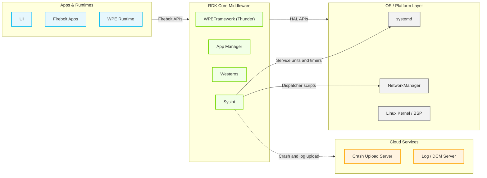

# Sysint

Sysint is the foundational system initialization and lifecycle management component in RDK middleware. It provides the runtime environment that all other middleware components depend on: consistent file-path abstractions, device identity resolution, network bring-up, security policy enforcement, and periodic system health monitoring. Sysint is a script-driven integration layer built from shell scripts, configuration property files, and systemd service and timer units, and it coordinates a growing set of companion compiled (C) executables that have replaced functionality previously implemented purely in shell — `/usr/bin/backup_logs` performs previous-boot log backup (invoked by `previous-log-backup.service`), `/usr/bin/logupload` performs DCM Agent log upload (invoked by `Start_MaintenanceTasks.sh`), and device reboot is delegated to an externally supplied `rebootNow` binary that Sysint only invokes, never implements. It acts as the operational integration layer that initializes the device from early boot through to an active, fully monitored state.

At the device level, Sysint ensures every RDK device boots into a known, reproducible operating state. It backs up logs from the previous boot cycle, enforces firewall rules, establishes secure remote-access sessions, initializes compressed swap space, drives the system clock signal chain, triggers crash artifact staging and upload, and recovers autonomously from network connectivity failures. It also coordinates state-change transitions such as factory reset, warehouse reset, and state-red firmware recovery, ensuring orderly teardown and restart of dependent services.

At the module level, Sysint exposes a reusable shell utility library (`utils.sh`), device property abstractions consumed by all other RDK scripts, and a catalogue of well-defined systemd service and timer units against which other components declare ordering dependencies. Its RFC integration layer reads feature-control parameters from the device configuration store at runtime, allowing behavior to be toggled without an image rebuild.



## Key Responsibilities & Modules

The table below summarizes Sysint's primary responsibilities and the files that implement them. For a full per-script/per-unit breakdown, see [Design & Architecture → Internal Modules](docs/DESIGN.md#internal-modules--full-functionality-mapping).

| Responsibility                   | Summary                                                                                                                                                                                                                                                                                                                                                                                                       | Key Files / Units                                                                                                      |
| -------------------------------- | ------------------------------------------------------------------------------------------------------------------------------------------------------------------------------------------------------------------------------------------------------------------------------------------------------------------------------------------------------------------------------------------------------------- | ---------------------------------------------------------------------------------------------------------------------- |
| `utils.sh` (Utility Library)     | Shared functions sourced by scripts that need them: `processCheck()`, `rebootFunc()`, `checkProcess()`, `getLastModifiedTimeOfFile()`.                                                                                                                                                                                                                                                                        | `lib/rdk/utils.sh`                                                                                                     |
| Log Management                   | Triggers the external `/usr/bin/backup_logs` binary via `previous-log-backup.service` to roll previous-boot logs into `PreviousLogs`; routes per-service journal output through syslog-ng; rotates logs via `logrotate`. Log upload is delegated to the DCM Agent's `/usr/bin/logupload` binary (the old `backup_logs.sh`/`uploadSTBLogs.sh`/`UploadLogsNow.sh`/`usbLogUpload.sh` scripts have been deleted). | `lib/rdk/logfiles.sh`, `systemd_units/previous-log-backup.service`                                                     |
| Network Management               | NetworkManager dispatcher scripts refresh the device IP/gateway cache on interface events; a periodic recovery service detects and remediates packet-loss and driver-level failures.                                                                                                                                                                                                                          | `lib/rdk/NM_Bootstrap.sh`, `lib/rdk/NM_Dispatcher.sh`, `lib/rdk/NM_preDown.sh`, `lib/rdk/networkConnectionRecovery.sh` |
| Security Enforcement             | Applies IPv4/IPv6 firewall rules at boot, manages the Dropbear SSH lifecycle with RFC-controlled access lists, and evaluates OCSP/CRL flags.                                                                                                                                                                                                                                                                  | `lib/rdk/iptables_init`, `lib/rdk/start_ssh.sh`, `lib/rdk/ocsp-support.sh`                                             |
| System Health Monitoring         | Periodically collects CPU, memory, process, and disk metrics, emitting Telemetry 2.0 markers.                                                                                                                                                                                                                                                                                                                 | `lib/rdk/system_info_collector.sh`, `lib/rdk/cpu-statistics.sh`, `lib/rdk/heap-usage-stats.sh`                         |
| Time Synchronization Event Chain | Monitors time-sync daemon flags and emits system-event-bus/D-Bus signals (`org.NtpSync.TimeSet`, `org.Systime.TimeSet`); the daemon is runtime-selectable between `chronyd`/`systemd-timesyncd` via `Device.Time.ChronyEnable`.                                                                                                                                                                               | `lib/rdk/send-time-events.sh`, `lib/rdk/getPartnerProperty.sh`, `systemd_units/ntp-event.service`                      |
| Crash and Dump Management        | Ensures the configured core-dump/mini-dump directories exist at boot; path units trigger the corresponding upload service via `uploadDumps.sh` when an artifact appears, for both secure and non-secure dump types, once the network is available.                                                                                                                                                            | `lib/rdk/dumpbackup.sh`, `systemd_units/coredump-upload.path`, `systemd_units/minidump-upload.path`                    |
| Disk Space Enforcement           | Monitors configured directory size thresholds and cleans stale log/cache files when persistent storage exceeds defined limits.                                                                                                                                                                                                                                                                                | `lib/rdk/disk_threshold_check.sh`, `lib/rdk/diskMon.sh`, `etc/diskMon.conf`                                            |
| Device Identity Resolution       | Resolves and caches the device identifier, partner identifier, IP, MAC, and model from provisioned data, falling back to bootstrap configuration or compile-time defaults.                                                                                                                                                                                                                                    | `lib/rdk/getDeviceId.sh`, `lib/rdk/getDeviceDetails.sh`                                                                |
| Reset & Recovery Orchestration   | Tears down dependent services and erases persistent state for factory/warehouse reset; triggers emergency firmware recovery. The final reboot in each case is delegated to an externally supplied `rebootNow` binary — reboot classification, cyclic-reboot guarding, and reboot-metadata persistence are **not** implemented in Sysint.                                                                      | `lib/rdk/factory-reset.sh`, `lib/rdk/warehouse-reset.sh`, `lib/rdk/stateRedRecovery.sh`                                |
| Compressed Swap Initialization   | Conditionally loads the `zram` kernel module and configures compressed swap partitions sized to a configurable percentage of total RAM.                                                                                                                                                                                                                                                                       | `lib/rdk/init-zram.sh`, `systemd_units/zram.service`                                                                   |
| Maintenance Task Orchestration   | Sequences RFC fetch, software update checks, and log upload, reporting status events to the system event bus at each stage.                                                                                                                                                                                                                                                                                   | `lib/rdk/Start_MaintenanceTasks.sh`                                                                                    |

---

## Directory Structure

```
sysint/
├── CHANGELOG.md
├── CONTRIBUTING.md
├── COPYING
├── LICENSE
├── Makefile                  # do_install() rules; stages lib/rdk, systemd_units, and etc/ into the image; creates rebootNow.sh/rebootSTB.sh compatibility symlinks
├── NOTICE
├── rdk_env.xml
├── README.md
├── .github/
│   ├── CODEOWNERS
│   └── workflows/            # CI / automated release workflows
├── etc/                      # Property files, RFC defaults, and daemon configs installed to /etc
│   ├── common.properties     # Build-level constants (BUILD_TYPE, LOG_PATH, UTILITY_PATH, ...)
│   ├── config.properties     # Crash/coredump upload server settings
│   ├── dcm.properties        # DCM Agent log server/upload endpoints
│   ├── device.properties     # Device-specific interface names and feature flags
│   ├── diskMon.conf          # Directory size thresholds monitored by diskMon.sh
│   ├── dnsmasq-dobby.conf    # dnsmasq interface binding for the Dobby container bridge
│   ├── env_setup.sh          # Shell aliases sourced by scripts that need them
│   ├── include.properties    # Filesystem path constants (LOG_PATH, PERSISTENT_PATH, RAMDISK_PATH, ...)
│   ├── lightsleep.conf       # Low-power/standby related configuration
│   ├── telemetry2_0.properties # Telemetry 2.0 binary path and log file locations
│   ├── 10-unmanaged-devices  # NetworkManager keyfile excluding virtual/container interfaces
│   ├── rc3.d/                # Legacy SysV runlevel placeholder (.gitignore only)
│   └── rfcdefaults/          # Default RFC parameter values applied before first RFC sync
│       ├── serial_config.ini
│       └── sysint-generic.ini
├── lib/rdk/                  # Shell utility scripts invoked by systemd units and other RDK components (see docs/DESIGN.md)
└── systemd_units/             # systemd .service, .timer, .path, .target, and ordering .conf unit files
```

---

## Documentation

- **[Design & Architecture](docs/DESIGN.md)** — design principles, the threading model, prerequisites and dependencies, the boot-to-active component state flow, hardware interface usage, key implementation logic, and the full per-file functionality mapping for every script and systemd unit.
- **[Configuration](docs/CONFIGURATION.md)** — key configuration files and their variables, RFC-controlled configuration parameters, build-time Yocto flags, runtime configuration behavior, and what persists across reboots.
- **[Component Interactions](docs/INTERACTIONS.md)** — the interaction matrix with other OS services, RDK middleware, cloud services, and Telemetry 2.0; events Sysint publishes; and IPC flow diagrams for NTP synchronization and network-up target activation.
