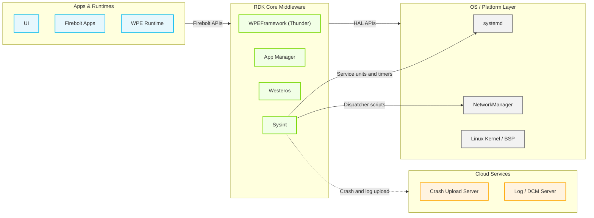
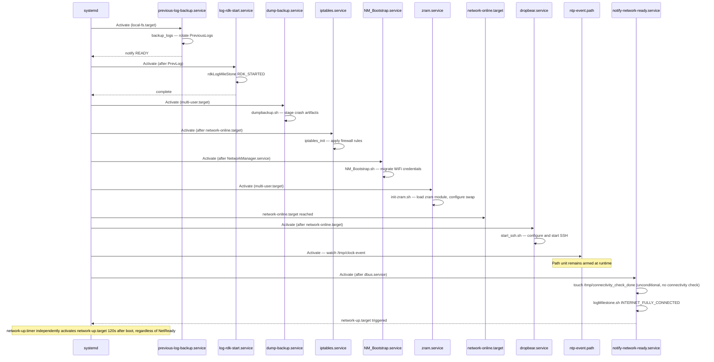
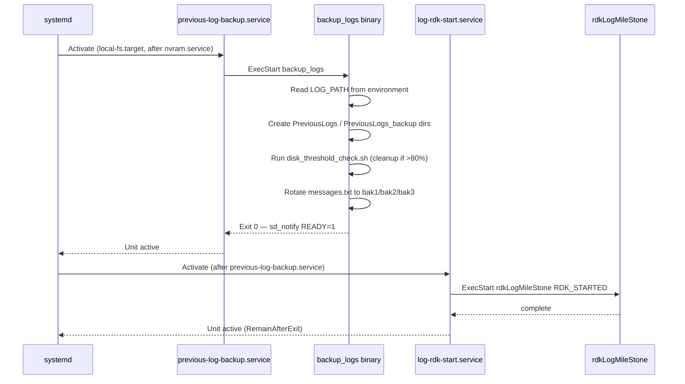
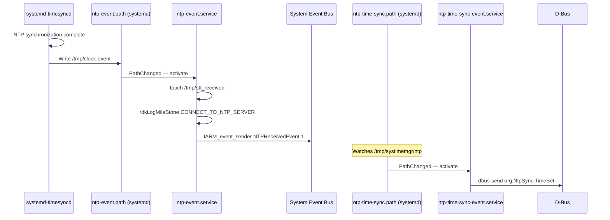
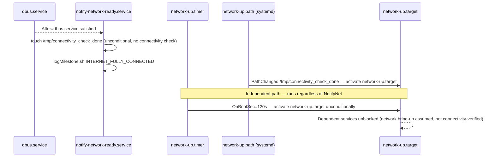

# Sysint

Sysint is the foundational system initialization and lifecycle management component in RDK middleware. It provides the runtime environment that all other middleware components depend on: consistent file-path abstractions, device identity resolution, network bring-up, security policy enforcement, and periodic system health monitoring. Sysint is a script-driven integration layer built from shell scripts, configuration property files, and systemd service and timer units, and it coordinates a growing set of companion compiled (C) executables that have replaced functionality previously implemented purely in shell — `/usr/bin/backup_logs` performs previous-boot log backup (invoked by `previous-log-backup.service`), `/usr/bin/logupload` performs DCM Agent log upload (invoked by `Start_MaintenanceTasks.sh`), and device reboot is delegated to an externally supplied `rebootNow` binary that Sysint only invokes, never implements. It acts as the operational integration layer that initializes the device from early boot through to an active, fully monitored state.

At the device level, Sysint ensures every RDK device boots into a known, reproducible operating state. It backs up logs from the previous boot cycle, enforces firewall rules, establishes secure remote-access sessions, initializes compressed swap space, drives the system clock signal chain, triggers crash artifact staging and upload, and recovers autonomously from network connectivity failures. It also coordinates state-change transitions such as factory reset, warehouse reset, and state-red firmware recovery, ensuring orderly teardown and restart of dependent services.

At the module level, Sysint exposes a reusable shell utility library (`utils.sh`), device property abstractions consumed by all other RDK scripts, and a catalogue of well-defined systemd service and timer units against which other components declare ordering dependencies. Its RFC integration layer reads feature-control parameters from the device configuration store at runtime, allowing behavior to be toggled without an image rebuild.



**Key Features & Responsibilities:**

- **Log Lifecycle Management**: Triggers the external `/usr/bin/backup_logs` binary via `previous-log-backup.service` to roll previous-boot log files into `PreviousLogs` directories before new log files are opened, routes service-specific journal output to dedicated log files under `/opt/logs/` through syslog-ng filter and destination rules (e.g., `system.log`, `dropbear.log`, `ntp.log`, `iptables.log`, `ConnectionStats.txt`), captures kernel log output via the journal into `messages.txt`, and runs periodic log rotation via `logrotate` to cap log directory sizes. The log backup and log upload logic itself has moved out of Sysint shell scripts (`backup_logs.sh`, `uploadSTBLogs.sh`, `UploadLogsNow.sh`, `usbLogUpload.sh` have all been deleted) into the DCM Agent and its companion `/usr/bin/backup_logs` / `/usr/bin/logupload` binaries; Sysint now only supplies the systemd trigger points, environment variables, and configuration (`dcm.properties`) that the DCM Agent consumes.
- **Network Management Integration**: Provides NetworkManager dispatcher scripts (`NM_Dispatcher.sh`, `NM_preDown.sh`) that refresh the device IP cache on interface state changes, and runs a periodic network connectivity recovery service that detects and remediates packet-loss and driver-level failures.
- **Security Enforcement**: Applies firewall rules through `iptables_init` at each boot after the network is available, manages the Dropbear SSH server lifecycle with RFC-controlled access lists, and evaluates OCSP/CRL status flags based on RFC parameters.
- **Crash and Dump Management**: Ensures the configured core-dump and mini-dump directories exist at boot; path units watch those directories and trigger the corresponding upload service via `uploadDumps.sh` when an artifact appears, for both secure and non-secure dump types, once the network is available.
- **Time Synchronization Event Chain**: Monitors filesystem flags set by the time-sync daemon and emits system event bus signals and D-Bus signals (`org.NtpSync.TimeSet`, `org.Systime.TimeSet`) that downstream components use to gate time-dependent operations. The active time-sync daemon is runtime-selectable between `chronyd` and `systemd-timesyncd`, controlled by the `Device.Time.ChronyEnable` RFC parameter — only one of the two is enabled at a time, and `getPartnerProperty.sh` resolves the corresponding NTP server and polling settings for whichever daemon is active.
- **System Health Monitoring**: Periodically collects CPU utilization, free memory, process table snapshots, and disk space metrics, emitting telemetry markers via the Telemetry 2.0 API.
- **Disk Space Enforcement**: Monitors configured directory size thresholds using `diskMon.conf` and performs cleanup of stale log and cache files when persistent storage exceeds defined limits.
- **Device Identity Resolution**: Resolves and caches the device identifier and partner identifier from provisioned data files, falling back to bootstrap configuration or compile-time defaults when provisioning files are absent.
- **Reset & Recovery Orchestration**: `factory-reset.sh` and `warehouse-reset.sh` tear down dependent services and erase persistent state before requesting a reboot, and `stateRedRecovery.sh` triggers an emergency recovery firmware download. The actual reboot request in each case is delegated to the externally supplied `rebootNow` binary (invoked as `/rebootNow.sh`) — reboot classification, cyclic-reboot guarding, and reboot-metadata persistence are implemented in that separate component, not in Sysint.
- **Compressed Swap Initialization**: Conditionally loads the `zram` kernel module and configures compressed swap partitions sized to a configurable percentage of total RAM, controlled by an RFC parameter.
- **Maintenance Task Orchestration**: Coordinates sequenced execution of RFC updates, software update checks, and log upload operations, reporting status events to the system event bus at each stage.

---

## Directory Structure

```
sysint/
├── CHANGELOG.md
├── CONTRIBUTING.md
├── COPYING
├── LICENSE
├── Makefile                  # do_install() rules; stages lib/rdk, systemd_units, and etc/ into the image; creates rebootNow.sh/rebootSTB.sh compatibility symlinks
├── NOTICE
├── rdk_env.xml
├── README.md
├── .github/
│   ├── CODEOWNERS
│   └── workflows/            # CI / automated release workflows
├── etc/                      # Property files, RFC defaults, and daemon configs installed to /etc
│   ├── common.properties     # Build-level constants (BUILD_TYPE, LOG_PATH, UTILITY_PATH, ...)
│   ├── config.properties     # Crash/coredump upload server settings
│   ├── dcm.properties        # DCM Agent log server/upload endpoints
│   ├── device.properties     # Device-specific interface names and feature flags
│   ├── diskMon.conf          # Directory size thresholds monitored by diskMon.sh
│   ├── dnsmasq-dobby.conf    # dnsmasq interface binding for the Dobby container bridge
│   ├── env_setup.sh          # Shell aliases sourced by scripts that need them
│   ├── include.properties    # Filesystem path constants (LOG_PATH, PERSISTENT_PATH, RAMDISK_PATH, ...)
│   ├── lightsleep.conf       # Low-power/standby related configuration
│   ├── telemetry2_0.properties # Telemetry 2.0 binary path and log file locations
│   ├── 10-unmanaged-devices  # NetworkManager keyfile excluding virtual/container interfaces
│   ├── rc3.d/                # Legacy SysV runlevel placeholder (.gitignore only)
│   └── rfcdefaults/          # Default RFC parameter values applied before first RFC sync
│       ├── serial_config.ini
│       └── sysint-generic.ini
├── lib/rdk/                  # Shell utility scripts invoked by systemd units and other RDK components (see Internal Modules and Functionality Mapping)
└── systemd_units/             # systemd .service, .timer, .path, .target, and ordering .conf unit files
```

---

## Design

Sysint is designed as a systemd-centric, script-driven integration layer. Rather than a single long-running daemon, it decomposes each functional responsibility into a dedicated, focused systemd unit — a service, timer, or path unit — that activates only when its specific trigger condition is met. This keeps each unit independently auditable, restartable, and orderable against other units without creating a central point of failure. Most behavior is still expressed in POSIX shell scripts that are easy to read, patch at the field level, and override by replacing individual files, but the design no longer avoids compiled code: performance- or security-sensitive responsibilities (previous-boot log backup, DCM log upload, reboot management) have been migrated to companion C binaries that Sysint's systemd units and shell scripts invoke rather than implement.

Scripts load shared property files as needed rather than under one universal contract. Scripts that source `utils.sh` inherit `/etc/common.properties`, `/etc/include.properties`, `/etc/device.properties`, and `/etc/env_setup.sh`, while standalone scripts source only the property files they require — for example `NM_Dispatcher.sh` sources only `/etc/device.properties` and `/etc/common.properties`, and `getPartnerProperty.sh` and `send-time-events.sh` source none of them. This allows paths such as `LOG_PATH`, `UTILITY_PATH`, and `PERSISTENT_PATH`, and interface names such as `ESTB_INTERFACE` and `WIFI_INTERFACE`, to be supplied per platform rather than hardcoded.

Interaction with the northbound RDK middleware (other systemd services, Thunder plugins) is achieved through two mechanisms: filesystem path units that watch for sentinel files written by those services, and system event bus signals dispatched by `IARM_event_sender` for coarser platform-wide event delivery. Interaction with the southbound OS layer uses standard POSIX interfaces — `systemctl`, `iptables`, `modprobe`, `dbus-send`, and procfs/sysfs.

Data created by Sysint that must survive across reboots is written to the persistent storage path (`/opt`). Previous-boot log snapshots are retained in `/opt/logs/PreviousLogs/`. Reboot metadata under `/opt/secure/reboot/` (`reboot.info`, `rebootCounter`) is written and read by the externally supplied `rebootNow` binary, not by Sysint scripts, though Sysint's reset scripts rely on it indirectly by invoking that binary. Transient state (PID lock files, connectivity flags, NTP event markers) is written to `/tmp` and is automatically discarded at each reboot.

RFC-controlled feature toggles are read at script invocation time via the `tr181Set` utility, enabling features such as ZRAM (`Device.DeviceInfo.X_RDKCENTRAL-COM_RFC.Feature.MEMSWAP.Enable`), USB storage auto-mount, OCSP/CRL policy, and SSH whitelist enforcement to be changed remotely without image reflash.

```mermaid
graph TD
    subgraph SysintComp["Sysint"]
        Utils["Utility Library<br/>utils.sh / logfiles.sh"]
        LM["Log Management<br/>backup_logs (C binary) · logrotate"]
        NMod["Network Management<br/>NM_Bootstrap · NM_Dispatcher<br/>networkConnectionRecovery"]
        SEC["Security<br/>iptables_init · start_ssh<br/>ocsp-support"]
        MON["System Monitoring<br/>system_info_collector<br/>cpu-statistics · heap-usage-stats"]
        TS["Time Sync Events<br/>ntp-event · send-time-events<br/>ntp-time-sync-event"]
        CRASH["Crash Management<br/>dumpbackup · coredump-upload<br/>minidump-upload"]
        DISK["Disk Management<br/>disk_threshold_check<br/>diskMon"]
        DID["Device Identity<br/>getDeviceId · getDeviceDetails"]
        SLC["Reset & Recovery<br/>factory-reset · warehouse-reset<br/>stateRedRecovery"]
        MEM["Memory Management<br/>init-zram"]
        MAINT["Maintenance<br/>Start_MaintenanceTasks"]
    end

    subgraph Ext["External Components"]
        NMSvc["NetworkManager"]
        Systemd["systemd"]
        DBus["D-Bus"]
        RFC["RFC / tr181Set"]
        CloudExt["Crash / Log Servers"]
        EvtBus["System Event Bus"]
    end

    Utils --> LM
    Utils --> NMod
    Utils --> SEC
    Utils --> MON
    Utils --> SLC
    NMod --> NMSvc
    TS --> DBus
    TS --> EvtBus
    CRASH --> CloudExt
    SEC --> RFC
    MEM --> RFC
    DID --> Systemd
    LM --> Systemd
    MAINT --> EvtBus
```



#### Threading Model

- **Threading Architecture**: All execution is through POSIX shell scripts; each service unit invocation runs as a single-threaded OS process.
- **Main Thread**: Each systemd-activated script runs as a dedicated short-lived process. One-shot services exit after completing their action; timer-triggered services are re-launched by the timer on each interval.
- **Background Execution**: Select scripts fork themselves into the background using the shell `&` operator (`init-zram.sh`, `getDeviceDetails.sh`) so that the parent systemd unit can return without blocking the boot target.
- **Synchronization**: Concurrent-instance protection is implemented with PID lock files (e.g., `/tmp/DiskCheck.pid` in `disk_threshold_check.sh`, `/tmp/SSH.pid` in `start_ssh.sh`). A script checks for an existing PID file and exits if a live instance is already running.
- **Async / Event Dispatch**: Systemd path units (`ntp-event.path`, `network-up.path`, `ntp-time-sync.path`, `restart-parodus.path`) watch filesystem paths and activate the corresponding service asynchronously when the watched file appears or changes, decoupling the writing component from the consuming service.

### Prerequisites and Dependencies

#### Platform and Integration Requirements

- **Build Dependencies**: `crashupload` component (Yocto `DEPENDS`); `syslog-ng-config-gen` and `logrotate_config` Yocto class inheritance for log routing and rotation rule generation.
- **Runtime Dependencies**: `bash`, `busybox` (declared as `RDEPENDS`); `logrotate`, `dropbear`, `NetworkManager`, `tr69hostif`, and `parodus` services must be present on the target image. Either `systemd-timesyncd` or `chronyd` must be present as the active time-sync daemon — the two are mutually exclusive and selected at runtime via the `Device.Time.ChronyEnable` RFC parameter.
- **Companion Executables**: Sysint's shell scripts and systemd units no longer implement log backup, log upload, or reboot management directly — they depend on separately built/installed binaries being present on the image: `/usr/bin/backup_logs` (invoked by `previous-log-backup.service`), `/usr/bin/logupload` (the DCM Agent binary invoked by `Start_MaintenanceTasks.sh`), and `/lib/rdk/rebootNow.sh` (an externally supplied reboot-management binary, symlinked at the image root by Sysint's `Makefile`).
- **Systemd Services**: The following services must be present before Sysint services reach full operational state: `nvram.service`, `securemount.service`, `tr69hostif.service`, `NetworkManager.service`, `dbus.service`, `network-online.target`.
- **Configuration Files**: `/etc/device.properties`, `/etc/common.properties`, `/etc/include.properties`, `/etc/env_setup.sh`, `/etc/diskMon.conf`, and `/etc/rfcdefaults/sysint-generic.ini` must be installed at the paths defined in `do_install()`.
- **Startup Order**: `previous-log-backup.service` runs before `log-rdk-start.service`; both run before `multi-user.target`. Crash and dump upload services declare `After=network-online.target`.

---

### Component State Flow

#### Initialization to Active State

On each boot, Sysint transitions through a fixed sequence governed by systemd ordering constraints. The earliest units (`previous-log-backup.service`, `log-rdk-start.service`) run before `multi-user.target` and are anchored to `local-fs.target`. Once the local filesystem and NVRAM are available, these units execute. A second wave of services activates at `multi-user.target`: `dump-backup.service`, `iptables.service`, `oops-dump.service`, `zram.service`, and `NM_Bootstrap.service`. A third wave, gated on `network-online.target`, activates the time-sync event chain, crash upload services, SSH daemon, and device detail refresh. `network-up.target` is activated through two independent, unconditional paths that do **not** verify internet connectivity: `notify-network-ready.service` touches `/tmp/connectivity_check_done` as soon as `dbus.service` is active (no connectivity check is performed), which `network-up.path` detects; and `network-up.timer` activates `network-up.target` directly 120 seconds after boot regardless of whether `notify-network-ready.service` has run. Either path unblocks services ordered after `network-up.target`, so that target should be read as "network bring-up assumed complete," not as confirmed internet connectivity.

The component transitions through the following states during its lifecycle: **LogRecovery** (backup previous logs, mark RDK_STARTED) → **SecuritySetup** (iptables rules, OCSP flags, ZRAM) → **NetworkBringup** (NM bootstrap, dispatcher registration) → **TimeSyncMonitoring** (NTP path watches active) → **Active** (all timers running, crash upload paths watching, connection stats running) → **Shutdown** (individual services are stopped via `systemctl stop`).



#### Runtime State Changes

Once all boot-time services have completed, Sysint operates through timer-driven and path-driven activations, re-entering active execution each time a timer fires or a watched filesystem path changes.

**State Change Triggers:**

- `vitalprocess-info.timer` fires 150 seconds after boot and every 600 seconds thereafter, invoking `system_info_collector.sh` to collect CPU, memory, disk, and process metrics and emit Telemetry 2.0 markers.
- `logrotate.timer` runs on its configured schedule, invoking `logrotate` against `/etc/logrotatedata.conf` to cap log file sizes.
- `disk-threshold-check.timer` periodically invokes `disk_threshold_check.sh` to detect and remediate persistent storage exceeding configured thresholds.
- `network-connection-stats.timer` periodically invokes `networkConnectionRecovery.sh` to check gateway reachability, packet loss, and WiFi driver health; it triggers reassociation or a driver reset when configurable thresholds are exceeded.
- `ntp-event.path` watches `/tmp/clock-event` (or `/run/systemd/timesync/synchronized` on Dunfell builds). When the time-sync daemon writes this file, `ntp-event.service` fires, dispatching a system event bus signal `NTPReceivedEvent` and logging the `CONNECT_TO_NTP_SERVER` milestone.
- `restart-parodus.path` watches `/tmp/authservice_parodus_restart`. When this file appears, `restart-parodus.service` invokes `systemctl restart parodus.service` after `wpeframework.service` is confirmed active.
- `stateRedRecovery.path` watches a sentinel file; when triggered, `stateRedRecovery.sh` initiates a recovery firmware download via `rdkvfwupgrader`.

**Context Switching Scenarios:**

- **Factory Reset**: `factory-reset.sh` stops dependent services (sysmgr, storagemgr, socprovisioning, lighttpd, dnsmasq, Dobby, WiFi), clears controller-pairing data and persistent state, and requests a reboot by invoking the external `rebootNow` binary.
- **Warehouse Reset**: `warehouse-reset.sh` follows a similar service teardown sequence with warehouse-specific data erasure.
- **State Red**: `stateRedRecovery.sh` calls `rdkvfwupgrader` with recovery parameters to initiate an emergency firmware download without requiring a full UI-driven update.
- **Cyclic Reboot Detection**: This guard is implemented in the externally supplied `rebootNow` binary, not in Sysint. Sysint's reset scripts simply call that binary; the counter at `/opt/secure/reboot/rebootCounter` and the pause-window logic (`REBOOT_CYCLE_THRESHOLD=5` within `REBOOT_WINDOW=10` minutes) are owned and maintained by the separate reboot-management component.

---

---

### Call Flows

#### Initialization Call Flow



> **Note:** Reboot management is **not** part of Sysint. Sysint's reset and recovery scripts (`factory-reset.sh`, `warehouse-reset.sh`, `stateRedRecovery.sh`, `utils.sh:rebootFunc()`) all delegate the actual restart to an externally supplied `rebootNow` binary (`/lib/rdk/rebootNow.sh`, symlinked at the image root by Sysint's `Makefile`). That binary's caller classification, cyclic-reboot guard, and reboot-metadata persistence are implemented and owned by that separate component and are out of scope for this README.

---

## Internal Modules

| Module / Class                   | Description                                                                                                                                                                                                                                                                                                                                                                                                                                                                                                                                                                                            | Key Files                                                                                                                                                                                                                                                                                                                                                                       |
| -------------------------------- | ------------------------------------------------------------------------------------------------------------------------------------------------------------------------------------------------------------------------------------------------------------------------------------------------------------------------------------------------------------------------------------------------------------------------------------------------------------------------------------------------------------------------------------------------------------------------------------------------------ | ------------------------------------------------------------------------------------------------------------------------------------------------------------------------------------------------------------------------------------------------------------------------------------------------------------------------------------------------------------------------------- |
| `utils.sh`                       | Shared utility functions sourced by all Sysint scripts: `processCheck()`, `rebootFunc()`, `checkProcess()`, `getLastModifiedTimeOfFile()`. Loads all property files in one place.                                                                                                                                                                                                                                                                                                                                                                                                                      | `lib/rdk/utils.sh`                                                                                                                                                                                                                                                                                                                                                              |
| `Log Management`                 | Backs up previous-boot log files to `PreviousLogs` and `PreviousLogs_backup` directories. `logfiles.sh` defines the known log file names and rotation targets. The external `/usr/bin/backup_logs` executable is invoked by `previous-log-backup.service` at each boot; log upload is likewise delegated to the external `/usr/bin/logupload` (DCM Agent) binary invoked from `Start_MaintenanceTasks.sh`.                                                                                                                                                                                             | `lib/rdk/logfiles.sh`, `systemd_units/previous-log-backup.service`                                                                                                                                                                                                                                                                                                              |
| `Network Management`             | `NM_Bootstrap.sh` migrates WiFi credentials and handles boot-type detection. `NM_Dispatcher.sh` refreshes IP cache and gateway information on NetworkManager interface events. `NM_preDown.sh` performs cleanup before an interface goes down. `networkConnectionRecovery.sh` monitors gateway reachability, packet loss, and WiFi driver state, and triggers self-healing actions.                                                                                                                                                                                                                    | `lib/rdk/NM_Bootstrap.sh`, `lib/rdk/NM_Dispatcher.sh`, `lib/rdk/NM_preDown.sh`, `lib/rdk/networkConnectionRecovery.sh`                                                                                                                                                                                                                                                          |
| `Security`                       | `iptables_init` applies IPv4 and IPv6 firewall rules, reading SSH and SNMP whitelist files from the RFC RAM path. `start_ssh.sh` configures Dropbear parameters from secure config files before the daemon is started. `ocsp-support.sh` reads RFC parameters and creates or removes `/tmp/.EnableOCSPStapling` and `/tmp/.EnableOCSPCA` flag files.                                                                                                                                                                                                                                                   | `lib/rdk/iptables_init`, `lib/rdk/start_ssh.sh`, `lib/rdk/ocsp-support.sh`                                                                                                                                                                                                                                                                                                      |
| `System Monitoring`              | `system_info_collector.sh` is the entry point for the `vitalprocess-info.timer`; it calls CPU statistics, memory reporting, top-process snapshots, and disk usage collection functions, emitting Telemetry 2.0 markers at each step. `cpu-statistics.sh` uses `iostat` to capture instantaneous CPU metrics and emits `cpuinfo_split` and `FREE_MEM_split` telemetry values. `heap-usage-stats.sh` reports ION heap layout and CPU temperature from sysfs (rdkstb only).                                                                                                                               | `lib/rdk/system_info_collector.sh`, `lib/rdk/cpu-statistics.sh`, `lib/rdk/heap-usage-stats.sh`                                                                                                                                                                                                                                                                                  |
| `Time Synchronization Events`    | `send-time-events.sh` sends D-Bus signals on the system bus: `org.Systime.TimeSet` for system-time-set events and `org.NtpSync.TimeSet` for NTP-sync events. The `ntp-event.service` dispatches the `NTPReceivedEvent` system event bus signal and marks the `CONNECT_TO_NTP_SERVER` log milestone. Path units watch filesystem flags to trigger these services asynchronously. `getPartnerProperty.sh` resolves NTP server, polling, and makestep settings via `tr181` for whichever daemon is active, including the `Device.Time.ChronyEnable` flag that selects `chronyd` over `systemd-timesyncd`. | `lib/rdk/send-time-events.sh`, `lib/rdk/getPartnerProperty.sh`, `systemd_units/ntp-event.service`, `systemd_units/ntp-event.path`, `systemd_units/ntp-time-sync.path`, `systemd_units/system-time-event.service`                                                                                                                                                                |
| `Crash Management`               | `dumpbackup.sh` ensures the configured core-dump and mini-dump directories exist at boot. Path units monitor dump directories, and the corresponding upload services invoke `uploadDumps.sh` when artifacts arrive.                                                                                                                                                                                                                                                                                                                                                                                    | `lib/rdk/dumpbackup.sh`, `systemd_units/coredump-upload.path`, `systemd_units/coredump-secure-upload.path`, `systemd_units/minidump-upload.path`, `systemd_units/minidump-secure-upload.path`, `systemd_units/coredump-upload.service`, `systemd_units/coredump-secure-upload.service`, `systemd_units/minidump-upload.service`, `systemd_units/minidump-secure-upload.service` |
| `Disk Management`                | `disk_threshold_check.sh` monitors `/opt` utilization and removes stale log and cache files when the fill level exceeds a configurable threshold (80% for flash, 90% for HDD). `diskMon.sh` independently verifies that specific directories do not exceed the size limits declared in `diskMon.conf`.                                                                                                                                                                                                                                                                                                 | `lib/rdk/disk_threshold_check.sh`, `lib/rdk/diskMon.sh`, `etc/diskMon.conf`                                                                                                                                                                                                                                                                                                     |
| `Device Identity`                | `getDeviceId.sh` resolves device ID and partner ID from provisioned data files, falling back to bootstrap configuration or a compile-time default. `getDeviceDetails.sh` caches device IP address, MAC address, and model information in `/tmp/.deviceDetails.cache` for consumption by other scripts and services.                                                                                                                                                                                                                                                                                    | `lib/rdk/getDeviceId.sh`, `lib/rdk/getDeviceDetails.sh`                                                                                                                                                                                                                                                                                                                         |
| `Reset & Recovery Orchestration` | `factory-reset.sh` and `warehouse-reset.sh` orchestrate service teardown and data erasure. `stateRedRecovery.sh` triggers emergency firmware download via `rdkvfwupgrader`. All three delegate the final reboot to an externally supplied `rebootNow` binary that is not part of this repository; Sysint does not implement reboot classification, cyclic-reboot guarding, or reboot-metadata persistence.                                                                                                                                                                                             | `lib/rdk/factory-reset.sh`, `lib/rdk/warehouse-reset.sh`, `lib/rdk/stateRedRecovery.sh`                                                                                                                                                                                                                                                                                         |
| `Memory Management`              | `init-zram.sh` reads the `MEMSWAP.Enable` RFC parameter, loads the `zram` kernel module with a device count matching the CPU count, and configures compressed swap partitions sized to a configurable percentage (default 50%) of total RAM.                                                                                                                                                                                                                                                                                                                                                           | `lib/rdk/init-zram.sh`, `systemd_units/zram.service`                                                                                                                                                                                                                                                                                                                            |
| `Maintenance Orchestration`      | `Start_MaintenanceTasks.sh` sequences RFC fetch, software update check, and log upload operations, dispatching system event bus progress and completion events at each stage for consumption by the Maintenance Manager plugin.                                                                                                                                                                                                                                                                                                                                                                        | `lib/rdk/Start_MaintenanceTasks.sh`                                                                                                                                                                                                                                                                                                                                             |

### Functionality Mapping (Full File Reference)

The table above groups the primary modules; the remaining scripts and systemd units in `lib/rdk/` and `systemd_units/` are mapped below by functionality.

**Crash & Diagnostics Logging**

| File                                        | Type          | Functionality                                                                                          |
| ------------------------------------------- | ------------- | ------------------------------------------------------------------------------------------------------ |
| `core_shell.sh`                             | script        | Handles core dump uploads to the crash portal and manages dump directory cleanup.                      |
| `diskCleanup.sh`                            | script        | Removes old coredump/cache files once `/opt/corefiles*` exceed the configured size threshold.          |
| `reportFailuresToSplunk.sh`                 | script        | Sends failure telemetry events to the Splunk endpoint resolved from RFC/DCM settings.                  |
| `vm_cpu_temp-check.sh`                      | script        | Collects VM/CPU temperature stats during light sleep (`temperature-telemetry.sh`, `vm-statistics.sh`). |
| `ubifs-node-setup`                          | script        | Sets up the kernel OOPS (panic) dump module on NAND or eMMC storage.                                   |
| `systemd_units/oops-dump.service`           | service       | Initializes kernel panic (OOPS) dump capture by running `ubifs-node-setup` after `local-fs.target`.    |
| `systemd_units/dumpdata.service` / `.timer` | service/timer | Runs `emmc_debug_launcher.sh` 900s after boot to collect eMMC debug data.                              |

**Firmware / Image Management**

| File                     | Type   | Functionality                                                                          |
| ------------------------ | ------ | -------------------------------------------------------------------------------------- |
| `imageFlasher.sh`        | script | Flashes firmware images to device storage (uses `/usr/bin/FlashApp` on media clients). |
| `eMMC_Upgrade.sh`        | script | Manages eMMC firmware upgrade with RFC version checks and retry tracking.              |
| `emmc_format.sh`         | script | Unmounts eMMC partitions ahead of format/upgrade operations.                           |
| `emmc_debug_launcher.sh` | script | Captures eMMC debug telemetry at a configurable interval.                              |
| `swupdate_utility.sh`    | script | Device-initiated firmware download handler integrated with DCM settings.               |
| `userInitiatedFWDnld.sh` | script | User-initiated firmware download with device state tracking.                           |
| `xconfImageCheck.sh`     | script | Checks firmware update status against the XConf configuration server.                  |
| `restore`                | script | Reverts to the previous firmware version from a `.prev.tgz` backup and reboots.        |
| `rfcOverrides.sh`        | script | Enables the SD-card scratchpad for firmware downloads when the RFC flag is set.        |

**Device Identity & Provisioning**

| File                       | Type   | Functionality                                                                           |
| -------------------------- | ------ | --------------------------------------------------------------------------------------- |
| `getPartnerId.sh`          | script | Retrieves partner ID / device ID from provisioned sources, WHOAMI RFC, or auth service. |
| `getAccountId.sh`          | script | Validates and retrieves the account ID from a `tr181` parameter.                        |
| `serialNumber.sh`          | script | Retrieves the device serial number from `tr181` or the kernel command line.             |
| `insertPartnerId.sh`       | script | Generates a UUID and sets up device/partner IDs for the auth service.                   |
| `isDeviceProvisioned`      | script | Returns success if device/partner ID provisioning files exist.                          |
| `getNonRootUserStatus.sh`  | script | Checks the non-root-user RFC flag and creates `/tmp/.EnableNonRootUser`.                |
| `readBTAddress-generic.sh` | script | Reads the device Bluetooth MAC address from hardware.                                   |

**Reset & Cleanup**

| File                      | Type   | Functionality                                                                           |
| ------------------------- | ------ | --------------------------------------------------------------------------------------- |
| `deviceReset.sh`          | script | Dispatches reset requests to the factory/warehouse/personality/user-reset handlers.     |
| `personality-reset.sh`    | script | Performs a personality reset by delegating to `factory-reset.sh`.                       |
| `userfactory-reset.sh`    | script | User-triggered factory reset; clears TTS language data then calls `warehouse-reset.sh`. |
| `restrictedModeUmount.sh` | script | Unmounts restricted-mode bind-mount filesystems under `/opt/restricted`.                |
| `restoreRootEnv.sh`       | script | Restores root ownership of system directories after restricted mode.                    |

**Disk & Storage Management**

| File                                                             | Type    | Functionality                                                               |
| ---------------------------------------------------------------- | ------- | --------------------------------------------------------------------------- |
| `disk_init`                                                      | script  | Initializes SD-card partitions with the expected TSB/APP layout.            |
| `disk_checkV2`                                                   | script  | Validates SD-card mount status, read/write access, and partition integrity. |
| `systemd_units/disk-check.service` / `disk-check-sdcard.service` | service | Run disk initialization/health checks after local filesystem mounts.        |
| `updateMountFailureCount.sh`                                     | script  | Aggregates mount-failure counters from `/tmp` into persistent storage.      |
| `systemd_units/mount-failure-count.service`                      | service | Runs `updateMountFailureCount.sh` on boot, after `nvram.service`.           |

**Network & Connectivity Extras**

| File                                                     | Type         | Functionality                                                                                 |
| -------------------------------------------------------- | ------------ | --------------------------------------------------------------------------------------------- |
| `ipv6addressChange.sh`                                   | script       | Logs IPv6 global-address acquisition and refreshes firewall rules.                            |
| `startLinkLocal.sh`                                      | script       | Starts `avahi-autoipd` for IPv4 link-local addressing on configured interfaces.               |
| `startTunnel.sh` / `startStunnel.sh`                     | script       | Manage SSH/stunnel reverse-tunnel lifecycle, including certificate handling.                  |
| `systemd_units/dnsmerge@.service` / `dnsmerge-upnp.path` | service/path | Merge DNS configuration fragments into `resolv.conf` when `/tmp/resolv.dnsmasq.upnp` changes. |
| `systemd_units/dropbear.service`                         | service      | Starts the Dropbear SSH daemon after network and `tr69hostif` are ready.                      |
| `systemd_units/NetworkManager.path`                      | path         | Triggers `NetworkManager` activation when `/tmp/bootType` appears.                            |
| `systemd_units/estb-interface-presetup.service`          | service      | Configures the default eSTB IP address and routes before `multi-user.target`.                 |

**USB & Input Device Control**

| File                                                                   | Type           | Functionality                                                     |
| ---------------------------------------------------------------------- | -------------- | ----------------------------------------------------------------- |
| `disableUSBEthernet.sh`                                                | script         | Validates USB Ethernet devices against a vendor/model allow-list. |
| `usbmodule-whitelist.sh` / `systemd_units/usbmodule-whitelist.service` | script/service | Loads permitted USB HID/storage kernel modules per RFC.           |
| `systemd_units/usb-input@.service`                                     | service        | Disables unauthorized USB input devices (templated per device).   |

**Power & Thermal Management**

| File                                        | Type    | Functionality                                                                     |
| ------------------------------------------- | ------- | --------------------------------------------------------------------------------- |
| `togglePower`                               | script  | Queries and toggles the device power state via `QueryPowerState`/`SetPowerState`. |
| `temperature-telemetry.sh`                  | script  | Collects board temperature from sysfs and reports it via `t2ValNotify`.           |
| `systemd_units/power-state-monitor.service` | service | Runs the `pwr-state-monitor` daemon to track power-state transitions.             |

**Time Synchronization Extras**

| File                                             | Type        | Functionality                                                                    |
| ------------------------------------------------ | ----------- | -------------------------------------------------------------------------------- |
| `timesyncd-conf-update.sh`                       | script      | Updates `systemd-timesyncd` NTP configuration from partner properties/bootstrap. |
| `systemd_units/system-time-event.service`        | service     | Runs `send-time-events.sh systimeset` after `dbus.service`.                      |
| `systemd_units/system-time-set.path` / `.target` | path/target | Watches `/tmp/systimeset` and activates `system-time-set.target`.                |

**Status Loggers & Telemetry**

| File                                                                                                                      | Type          | Functionality                                                                 |
| ------------------------------------------------------------------------------------------------------------------------- | ------------- | ----------------------------------------------------------------------------- |
| `vm-statistics.sh`                                                                                                        | script        | Collects virtual-memory statistics (`vmstat`) for Telemetry 2.0.              |
| `systemd_units/av-status-logger.service`                                                                                  | service       | Logs audio/video decoder status.                                              |
| `systemd_units/proc-status-logger.service` / `.timer`                                                                     | service/timer | Periodically logs SOC processor status.                                       |
| `systemd_units/rf-status-logger.service`                                                                                  | service       | Collects RF (radio) statistics after `network-online.target`.                 |
| `systemd_units/eth-connection-stats.timer`, `network-statistics.timer`, `hddstatuslogger.timer`, `mocastatuslogger.timer` | timer         | Periodic Ethernet, upstream network, disk-health, and MoCA status collection. |
| `systemd_units/vitalprocess-info.service`                                                                                 | service       | Runs `system_info_collector.sh`, triggered by `vitalprocess-info.timer`.      |

**Security & Certificates**

| File                                 | Type    | Functionality                                                               |
| ------------------------------------ | ------- | --------------------------------------------------------------------------- |
| `copyPRCerts.sh`                     | script  | Copies PlayReady DRM certificates into `/opt/drm/`.                         |
| `cleanAdobe.sh`                      | script  | Cleans Adobe DRM and Netflix secure data on STB version change.             |
| `systemd_units/ocsp-support.service` | service | Runs `ocsp-support.sh` after `securemount.service` to apply OCSP RFC flags. |

**Content & Application Management**

| File                                      | Type   | Functionality                                                                    |
| ----------------------------------------- | ------ | -------------------------------------------------------------------------------- |
| `bundleUtils.sh` / `cdlSupport.sh`        | script | Parse and manage software bundle / content-delivery-layer metadata.              |
| `netflixPreStart.sh`                      | script | Pre-startup setup for the Netflix application (UID/GID, DRM ownership).          |
| `systemd_units/netflix-download-lxc.path` | path   | Watches `/tmp/.netflix-download-lxc` and triggers the Netflix container service. |

**Cron, Scheduling & Misc Utilities**

| File                                                                | Type    | Functionality                                                                           |
| ------------------------------------------------------------------- | ------- | --------------------------------------------------------------------------------------- |
| `cronjobs_update.sh` / `add_cron_jobs.sh`                           | script  | Add, update, and verify crontab entries for periodic monitoring scripts.                |
| `init-functions`                                                    | script  | Shared shell initialization/formatting helpers (sourced by init-style scripts).         |
| `module-starter`                                                    | script  | Generic module-startup wrapper that redirects output to a log pipe.                     |
| `alertSystem.sh`                                                    | script  | Dispatches alert messages to backend endpoints via `exec_curl_mtls.sh`.                 |
| `fkps.sh`                                                           | script  | Resolves Kaleidescape Provisioning Server URLs from RFC or config.                      |
| `getTimeZone.sh`                                                    | script  | Resolves device timezone from provisioning files or properties.                         |
| `timestamp`                                                         | script  | Prints an ISO-format timestamp used in every script's log line.                         |
| `systemd_units/htmldiag-pre.service`                                | service | Pre-setup for the HTML diagnostics interface after `network-online.target`.             |
| `systemd_units/update-device-details.service` / `.conf`             | service | Runs `getDeviceDetails.sh` after network is online to refresh the device-details cache. |
| `systemd_units/systemd-tmpfiles-setup.conf`, `after_syslog-ng.conf` | conf    | Unit-ordering constraints (`/var/lib` mount, `syslog-ng.service` ordering).             |

---

---

## Component Interactions

### Interaction Matrix

| Target Component / Layer           | Interaction Purpose                                                                                                                                                                                                                                   | Key APIs / Topics                                                                                                    |
| ---------------------------------- | ----------------------------------------------------------------------------------------------------------------------------------------------------------------------------------------------------------------------------------------------------- | -------------------------------------------------------------------------------------------------------------------- |
| **OS Services**                    |                                                                                                                                                                                                                                                       |                                                                                                                      |
| `NetworkManager`                   | Receives IP add/del events and pre-down notifications via dispatcher scripts registered in `/etc/NetworkManager/dispatcher.d/`                                                                                                                        | `NM_Dispatcher.sh`, `NM_preDown.sh`                                                                                  |
| `systemd-timesyncd` / `chronyd`    | Path unit watches the time-sync sentinel file to trigger NTP event dispatch; the active daemon (one or the other, never both) is selected via the `ChronyEnable` RFC flag, and `getPartnerProperty.sh` supplies its NTP server and polling parameters | `ntp-event.path` watches `/tmp/clock-event` (or `/run/systemd/timesync/synchronized`); `Device.Time.ChronyEnable`    |
| `parodus.service`                  | Restarts parodus after WPEFramework signals readiness, triggered by the `authservice_parodus_restart` sentinel                                                                                                                                        | `restart-parodus.path`, `systemctl restart parodus.service`                                                          |
| `logrotate`                        | Periodic log file rotation using Sysint-installed configuration                                                                                                                                                                                       | `logrotate.service` invokes `/usr/sbin/logrotate -s ... /etc/logrotatedata.conf`                                     |
| `dnsmasq` / Dobby container bridge | Supplies DNS resolution on the `dobby0` container interface used by Dobby-hosted applications                                                                                                                                                         | `etc/dnsmasq-dobby.conf` (`interface=dobby0`)                                                                        |
| **RDK Middleware Components**      |                                                                                                                                                                                                                                                       |                                                                                                                      |
| `WPEFramework` (Thunder)           | Stopped/restarted as part of factory reset, warehouse reset, and the parodus-restart flow; `restart-parodus.service` waits for `wpeframework.service` to be active before restarting parodus                                                          | `systemctl stop/restart wpeframework.service` in `factory-reset.sh`, `warehouse-reset.sh`, `restart-parodus.service` |
| Dobby container runtime            | Stopped during factory/warehouse reset teardown; provided DNS resolution via `dnsmasq-dobby.conf`                                                                                                                                                     | `systemctl stop Dobby` in `factory-reset.sh`/`warehouse-reset.sh`                                                    |
| DCM Agent (`/usr/bin/logupload`)   | Performs the actual log-upload transfer; Sysint only triggers it and supplies `dcm.properties`/`DCMSettings.conf` context                                                                                                                             | `LOG_UPLOAD_BIN_PATH=/usr/bin/logupload` in `Start_MaintenanceTasks.sh`                                              |
| Reboot-management binary           | External component that owns reboot classification, cyclic-reboot guarding, and reboot metadata; invoked (never implemented) by Sysint's reset scripts                                                                                                | `/rebootNow.sh` invoked from `factory-reset.sh`, `warehouse-reset.sh`, `utils.sh:rebootFunc()`                       |
| `rdkvfwupgrader`                   | Performs firmware download/flash on behalf of maintenance tasks and state-red recovery                                                                                                                                                                | `SWUPDATE_BIN=$COMMON_BIN_LOCATION/rdkvfwupgrader` in `Start_MaintenanceTasks.sh`; `stateRedRecovery.sh`             |
| `syslog-ng`                        | Routes per-service journal output into dedicated log files under `/opt/logs/` using build-time generated filter/destination rules                                                                                                                     | `SYSLOG-NG_*` Yocto recipe variables; `systemd_units/after_syslog-ng.conf`                                           |
| **System Event Bus**               |                                                                                                                                                                                                                                                       |                                                                                                                      |
| Event bus signal sender            | Dispatches `NTPReceivedEvent` to the platform-wide event bus on NTP synchronization                                                                                                                                                                   | `IARM_event_sender NTPReceivedEvent 1` in `ntp-event.service`                                                        |
| Event bus signal sender            | Dispatches maintenance progress and completion events during RFC, firmware update, and log upload sequences                                                                                                                                           | `IARM_event_sender` calls in `Start_MaintenanceTasks.sh`                                                             |
| **D-Bus**                          |                                                                                                                                                                                                                                                       |                                                                                                                      |
| `org.Systime`                      | Broadcasts `TimeSet` signal when system time is set to last-known-good or build time                                                                                                                                                                  | `dbus-send --system … org.Systime.TimeSet`                                                                           |
| `org.NtpSync`                      | Broadcasts `TimeSet` signal on NTP sync completion or 180-second expiry                                                                                                                                                                               | `dbus-send --system … org.NtpSync.TimeSet`                                                                           |
| **RFC / Configuration Store**      |                                                                                                                                                                                                                                                       |                                                                                                                      |
| `tr181Set` / `tr181` utility       | Reads RFC-controlled feature flags at script invocation time                                                                                                                                                                                          | `Device.DeviceInfo.X_RDKCENTRAL-COM_RFC.Feature.*` parameters                                                        |
| **Cloud Services**                 |                                                                                                                                                                                                                                                       |                                                                                                                      |
| Crash upload server                | Transfers core dumps and mini-dumps via the `uploadDumps.sh` helper after network is available                                                                                                                                                        | `coredump-upload.service`, `minidump-upload.service`                                                                 |
| DCM / log upload server            | Receives uploaded logs from the `/usr/bin/logupload` DCM Agent binary                                                                                                                                                                                 | `etc/dcm.properties` (`DCM_LOG_SERVER`, `DCM_LOG_SERVER_URL`, `DCM_SCP_SERVER`)                                      |
| XConf / firmware update server     | Supplies firmware update availability and download location, consumed by `xconfImageCheck.sh` and `rdkvfwupgrader`                                                                                                                                    | `swupdate_utility.sh`, `xconfImageCheck.sh`                                                                          |
| **Telemetry 2.0**                  |                                                                                                                                                                                                                                                       |                                                                                                                      |
| `t2Shared_api.sh`                  | Emits telemetry markers for CPU, memory, and network statistics                                                                                                                                                                                       | `t2ValNotify "cpuinfo_split"`, `t2ValNotify "FREE_MEM_split"`, `t2ValNotify "ConnectionStats"`                       |

### Events Published

| Event Name                 | Topic / Signal    | Trigger Condition                                                                                                                                                                                                                                                                      | Subscriber Components                                    |
| -------------------------- | ----------------- | -------------------------------------------------------------------------------------------------------------------------------------------------------------------------------------------------------------------------------------------------------------------------------------- | -------------------------------------------------------- |
| `NTPReceivedEvent`         | System event bus  | Time-sync daemon writes `/tmp/clock-event` (path unit fires)                                                                                                                                                                                                                           | Time-dependent middleware services                       |
| `org.Systime.TimeSet`      | D-Bus system bus  | `system-time-set.target` activated                                                                                                                                                                                                                                                     | Services listening on D-Bus for system time availability |
| `org.NtpSync.TimeSet`      | D-Bus system bus  | `ntp-time-sync.target` activated                                                                                                                                                                                                                                                       | Services listening on D-Bus for NTP synchronization      |
| `INTERNET_FULLY_CONNECTED` | RDK log milestone | `notify-network-ready.service` touches the sentinel unconditionally once `dbus.service` is active, or `network-up.timer` fires 120s after boot — neither path verifies actual internet connectivity, so this milestone name is aspirational rather than a confirmed-connectivity check | Log analysis, boot milestone tracking                    |
| `RDK_STARTED`              | RDK log milestone | `log-rdk-start.service` runs before `multi-user.target`                                                                                                                                                                                                                                | Boot milestone tracking                                  |
| Maintenance status events  | System event bus  | Each phase of RFC fetch, firmware update, and log upload                                                                                                                                                                                                                               | Maintenance Manager plugin                               |

### IPC Flow Patterns

**NTP Event Notification Flow:**

The NTP event chain is driven entirely by filesystem path monitoring. No polling occurs: systemd watches the sentinel file, and the event dispatch service activates only when the condition is met.



**Network-Up Target Activation Flow:**

`network-up.target` marks that network bring-up is assumed complete; it is not a verified-connectivity signal. `NM_Dispatcher.sh` only refreshes the local IP/gateway cache on interface events and has no relationship to `notify-network-ready.service` or `network-up.timer` — the two activation paths below are independent of it and of each other.



---

## Implementation Details

### Hardware Interface Usage

Sysint interacts with hardware through standard Linux kernel interfaces. CPU and memory metrics are read from procfs paths including `/proc/cpuinfo` and `/proc/uptime`. Thermal readings and ION heap information are retrieved from sysfs at `/sys/class/thermal/thermal_zone0/temp` and `/sys/kernel/debug/ion/heaps/`. Storage utilization is measured using `df` and filesystem utilities. Kernel modules including `zram` are managed via `modprobe`. Network packet filtering rules are applied through `iptables` and `ip6tables` calls within `iptables_init`.

### Key Implementation Logic

- **State / Lifecycle Management**: Factory and warehouse reset states are signaled to dependent services by stopping them via `systemctl stop` before clearing data; the final reboot request is delegated to the externally supplied `rebootNow` binary, which owns the reboot counter and metadata files under `/opt/secure/reboot/` (`reboot.info`, `rebootCounter`) — this state is not tracked by Sysint itself.
  - Reset orchestration: `lib/rdk/factory-reset.sh`, `lib/rdk/warehouse-reset.sh`, `lib/rdk/stateRedRecovery.sh`

- **Event Processing**: All event dispatch in Sysint is one-shot and synchronous within the activating script. Systemd path units provide the asynchronous edge-trigger mechanism: the component that writes the sentinel file is decoupled from the consuming service — each side operates independently. System event bus notifications are dispatched as fire-and-forget calls via the `IARM_event_sender` utility.

- **Error Handling Strategy**: Scripts use early-exit patterns when mandatory arguments or files are missing (e.g., `getPartnerProperty.sh` exits with a usage message if its single required argument is missing). Disk threshold checks write a PID lock file and exit immediately if a concurrent instance is detected. The network recovery script tracks consecutive failure counts per condition type before taking corrective action, avoiding false-positive resets.

- **Logging & Diagnostics**: All scripts use a consistent log pattern: ``echo "`/bin/timestamp`: $0: $*" >> $LOG_FILE``. `Start_MaintenanceTasks.sh` maintains dedicated per-task logs (`rfcscript.log`, `swupdate.log`, `dcmscript.log`) under `$LOG_PATH`. The network recovery script writes to `/opt/logs/ConnectionStats.txt`. Systemd unit logs are captured by syslog-ng into service-specific destinations configured at build time via the `SYSLOG-NG_*` variables in the Yocto recipe.

---

## Configuration

### Key Configuration Files

| Configuration File                    | Purpose                                                                                                                                                                        | Override Mechanism                                                     |
| ------------------------------------- | ------------------------------------------------------------------------------------------------------------------------------------------------------------------------------ | ---------------------------------------------------------------------- |
| `/etc/device.properties`              | Device-specific properties: interface names (`ESTB_INTERFACE`, `WIFI_INTERFACE`, `ETHERNET_INTERFACE`), feature flags (`WIFI_SUPPORT`, `HDD_ENABLED`, `DEVICE_TYPE`), hostname | Replaced per-device variant at build time                              |
| `/etc/common.properties`              | Build-level constants: `BUILD_TYPE`, `LOG_PATH`, `CRASH_SVR` addresses, `UTILITY_PATH`, `RW_PATH`                                                                              | Replaced per-build configuration                                       |
| `/etc/include.properties`             | Filesystem path constants: `LOG_PATH`, `PERSISTENT_PATH`, `RAMDISK_PATH`, `UTILITY_PATH`, `RDK_PATH`, `DUMP_EXTN`                                                              | Replaced per-platform at build time                                    |
| `/etc/config.properties`              | Crash and log server upload settings: server addresses, ports, credentials paths                                                                                               | Replaced per-deployment environment                                    |
| `/etc/env_setup.sh`                   | Shell environment aliases (`reboot`, `ps`, `date -u`, `journalctl --utc`) applied to every Sysint shell session                                                                | Sourced by all scripts; replicated per platform                        |
| `/etc/diskMon.conf`                   | Directory paths and maximum sizes (MB) monitored by `diskMon.sh`                                                                                                               | Edited in-image or replaced by a platform layer                        |
| `/etc/rfcdefaults/sysint-generic.ini` | Default RFC parameter values for Sysint features: mTLS upload flags, secure dump, standby reboot interval                                                                      | Overridden at runtime by RFC server push                               |
| `/etc/dcm.properties`                 | DCM Agent log-upload endpoints consumed by the `/usr/bin/logupload` binary                                                                                                     | Overridden per-deployment via `/opt/dcm.properties` on non-prod builds |
| `/etc/telemetry2_0.properties`        | Path to the Telemetry 2.0 binary and its log files, used by every script that calls `t2ValNotify`/`t2CountNotify`                                                              | Replaced per-platform at build time                                    |
| `/etc/dnsmasq-dobby.conf`             | Binds `dnsmasq` to the Dobby container bridge interface (`dobby0`)                                                                                                             | Replaced per-platform at build time                                    |
| `/etc/10-unmanaged-devices`           | NetworkManager keyfile excluding virtual/container interfaces (`dobby*`, `veth*`, `wl0.2`, ...) from management                                                                | Edited in-image or replaced by a platform layer                        |
| `/etc/rfcdefaults/serial_config.ini`  | Default serial-console (UART) parameters and the RDK service-store path                                                                                                        | Overridden at runtime by RFC server push                               |

### Configuration File Variable Reference

- **`/etc/device.properties`** — Per-device identity and capability flags: `DEVICE_TYPE`, `HOSTNAME`, `BLUETOOTH_ENABLED`, `HDD_ENABLED`, `WIFI_SUPPORT`, `RDK_EMULATOR`, `LABSIGNED_ENABLED`; interface names `ESTB_INTERFACE`, `ETHERNET_INTERFACE`, `WIFI_INTERFACE`, `MOCA_INTERFACE`, `UDHCP_INTERFACE`, `WAN_INTERFACE`, `HTTPD_INTERFACE`; default network addressing `DEFAULT_IP`, `DEFAULT_ESTB_IP`, `DEFAULT_ECM_IP`, `GATEWAY_IP`, `NETWORK_ID`; `DCM_LOG_PATH`; Dropbear identity `POTOMAC_USER`, `POTOMAC_IDENTITY_FILE`; crash-portal reachability `CRASH_PORTAL_PATH`, `CRASH_PORTAL_SERVER`, `CRASH_PORTAL_USER`; `SCHEDULE_REBOOT_INTERVAL` (used by the external reboot-management binary, not Sysint).
- **`/etc/common.properties`** — Build-wide constants: `BUILD_TYPE` (`dev`/`prod`, gates whether `/opt/*.properties` overrides are honored), `LOG_PATH`, `UTILITY_PATH`, `RW_PATH`, `DUMP_EXTN`, `BUILD_VERSION`, `INTERFACE`/`UDHCP_IF`/`DEFAULT_IP` defaults, `PROXY_FILE`, `DEFAULT_PROXY_PORT`, `POTOMAC_SVR`, `REBOOT_INTERVAL`, `PERF_TEST`, `IP_ONLY`.
- **`/etc/include.properties`** — Filesystem path constants sourced by nearly every script: `LOG_PATH`, `PERSISTENT_PATH` (`/opt`), `RAMDISK_PATH` (`/tmp`), `TEMP_LOG_PATH`, `UTILITY_PATH`/`RDK_PATH` (`/lib/rdk`), `DUMPFILE_EXTN`/`DUMP_EXTN`, `CRON_SPOOL`, `CRON_FIFO_FILE`, `DIRECT_BLOCK_TIME`, `CB_BLOCK_TIME`.
- **`/etc/config.properties`** — Crash/coredump upload transport settings: `PORTAL_URL`, `POTOMAC_USER`, `POTOMAC_IDENTITY_FILE`, `CRASH_PORTAL_PATH`, `CRASH_SERVER_COREDUMP_PORT`, `CRASH_SERVER_MINIDUMP_PORT`, `POTOMAC_SVR`.
- **`/etc/dcm.properties`** — DCM Agent endpoints: `LOG_SERVER`, `DCM_LOG_SERVER`, `DCM_LOG_SERVER_URL`, `DCM_SCP_SERVER`, `HTTP_UPLOAD_LINK`, `DCA_UPLOAD_URL`; sourced by `Start_MaintenanceTasks.sh` and `reportFailuresToSplunk.sh`.
- **`/etc/env_setup.sh`** — Shell aliases applied where sourced: `reboot`, `ps`, `tftp`, `top`, `date -u`, and a conditional `journalctl --utc` alias.
- **`/etc/diskMon.conf`** — A `path size_in_MB` list (e.g. `/opt/logs/ 500`, `/opt/corefiles/ 1000`, `/opt/minidumps/ 500`) consumed line-by-line by `diskMon.sh`.
- **`/etc/telemetry2_0.properties`** — `T2_0_BIN`, `T2_0_APP`, `T2_0_LOGFILE`, `DCM_LOG_FILE`.
- **`/etc/dnsmasq-dobby.conf`** — Single `interface=dobby0` directive binding `dnsmasq` to the Dobby container network.
- **`/etc/10-unmanaged-devices`** — NetworkManager `[keyfile]` section listing interface-name globs NetworkManager must not manage.
- **`/etc/rfcdefaults/sysint-generic.ini`** — Default values for the mTLS, secure-dump, and standby-reboot RFC parameters listed in Key Configuration Parameters below, applied before the device's first successful RFC sync.
- **`/etc/rfcdefaults/serial_config.ini`** — Default `[SerialConfig]` values: `port`, `baudrate`, `charactersize`, `flowcontrol`, `parity`, `stopbits`, and `rdkservicestorepath`.

### Key Configuration Parameters

| Parameter                                                                        | Type | Default                   | Description                                                                                                                                       |
| -------------------------------------------------------------------------------- | ---- | ------------------------- | ------------------------------------------------------------------------------------------------------------------------------------------------- |
| `Device.DeviceInfo.X_RDKCENTRAL-COM_RFC.Feature.MEMSWAP.Enable`                  | bool | `false`                   | Enables ZRAM compressed swap initialization on boot.                                                                                              |
| `Device.Time.ChronyEnable`                                                       | bool | —                         | Selects `chronyd` as the active time-sync daemon instead of `systemd-timesyncd`; the two are mutually exclusive. Read by `getPartnerProperty.sh`. |
| `Device.DeviceInfo.X_RDKCENTRAL-COM_RFC.Feature.SecDump.Enable`                  | bool | `true`                    | Enables secure (encrypted) crash dump collection path.                                                                                            |
| `Device.DeviceInfo.X_RDKCENTRAL-COM_RFC.Feature.StandbyReboot.Enable`            | bool | `true`                    | Enables automatic reboot from standby after the configured interval.                                                                              |
| `Device.DeviceInfo.X_RDKCENTRAL-COM_RFC.Feature.StandbyReboot.StandbyAutoReboot` | int  | `86400`                   | Standby auto-reboot interval in seconds (default 24 hours).                                                                                       |
| `Device.DeviceInfo.X_RDKCENTRAL-COM_RFC.Feature.MTLS.mTlsDCMUpload.Enable`       | bool | `true`                    | Enforces mutual TLS for DCM log upload.                                                                                                           |
| `Device.DeviceInfo.X_RDKCENTRAL-COM_RFC.Feature.MTLS.mTlsCrashdumpUpload.Enable` | bool | `true`                    | Enforces mutual TLS for crash dump upload.                                                                                                        |
| `Device.DeviceInfo.X_RDKCENTRAL-COM_RFC.Feature.CRL.Enable`                      | bool | —                         | Enables OCSP stapling; controls creation of `/tmp/.EnableOCSPStapling`.                                                                           |
| `Device.DeviceInfo.X_RDKCENTRAL-COM_RFC.Feature.CRL.DirectOCSP`                  | bool | —                         | Enables direct OCSP CA validation; controls creation of `/tmp/.EnableOCSPCA`.                                                                     |
| `Device.DeviceInfo.X_RDKCENTRAL-COM_RFC.Feature.USB_AutoMount.Enable`            | bool | —                         | Controls whether the `usb-storage` kernel module is loaded at boot.                                                                               |
| `DEFAULT_THRESHOLD_SIZE`                                                         | int  | `80` (flash) / `90` (HDD) | Persistent storage fill percentage at which disk cleanup is triggered.                                                                            |
| `ZRAM_MEM_MAX_PERCENTAGE`                                                        | int  | `50`                      | Maximum percentage of total RAM allocated to ZRAM swap devices, read from `device.properties`.                                                    |

### Build-Time Configurations

The following flags are evaluated in the Yocto recipe's `do_install()` and control which files and properties are deployed into the image. They are derived from `DISTRO_FEATURES` and `bb.utils.contains` conditional evaluations in `sysint_git.bb`.

| Flag                     | `DISTRO_FEATURES` Condition                                      | Effect                                                                                                                             |
| ------------------------ | ---------------------------------------------------------------- | ---------------------------------------------------------------------------------------------------------------------------------- |
| `BIND_ENABLED`           | `bind`                                                           | Appends `BIND_ENABLED=true` to `device-middleware.properties`                                                                      |
| `MMC_TYPE = EMMC`        | `storage_emmc`                                                   | Appends `SD_CARD_TYPE=EMMC`; retains `emmc_format.sh` in the image                                                                 |
| `FORCE_MTLS`             | `mtls_only`                                                      | Appends `FORCE_MTLS=true` to `device-middleware.properties`                                                                        |
| `ENABLE_MAINTENANCE`     | `enable_maintenance_manager`                                     | Appends `ENABLE_MAINTENANCE=true`; activates software opt-out if also set                                                          |
| `ENABLE_SOFTWARE_OPTOUT` | `enable_software_optout` (requires `enable_maintenance_manager`) | Appends `ENABLE_SOFTWARE_OPTOUT=true`                                                                                              |
| `ENABLE_SYSLOGNG`        | `syslog-ng`                                                      | Activates `syslog-ng-config-gen` class; configures per-service log destinations and rate limits defined by `SYSLOG-NG_*` variables |
| `DUNFELL_BUILD`          | `dunfell`                                                        | Replaces the `ntp-event.path` watched path from `/tmp/clock-event` to `/run/systemd/timesync/synchronized`                         |
| `STG_TYPE = SDCARD`      | `storage_sdc`                                                    | Activates rdkstb-specific `disk-check.service` and `usbmodule-whitelist.service`                                                   |

### Runtime Configuration

RFC parameters can be updated remotely via the RFC server. After a parameter push, the feature takes effect at the next activation of the relevant Sysint script — timer-driven services apply the change on the next timer interval, while one-shot boot services apply it on the next reboot. SSH whitelist and SNMP whitelist files can be refreshed at runtime by placing updated list files in the RFC RAM path (`/tmp/RFC/.RFC_SSHWhiteList.list`) and invoking `iptables_init` with the refresh flag.

### Configuration Persistence

Device properties (`/etc/device.properties`, `/etc/include.properties`, `/etc/common.properties`) are baked into the image and remain constant across reboots. RFC parameter overrides are stored in `/opt/persistent/rfc.properties` (non-production builds) or read from `/etc/rfc.properties` (production builds) and persist across reboots. The device details cache at `/tmp/.deviceDetails.cache` is managed by Sysint scripts directly and is refreshed each boot cycle in `/tmp`. Reboot metadata under `/opt/secure/reboot/` persists across reboots but is owned and written by the externally supplied `rebootNow` binary, not by Sysint. Log files under `/opt/logs/` are retained across reboots and managed by `logrotate`.
