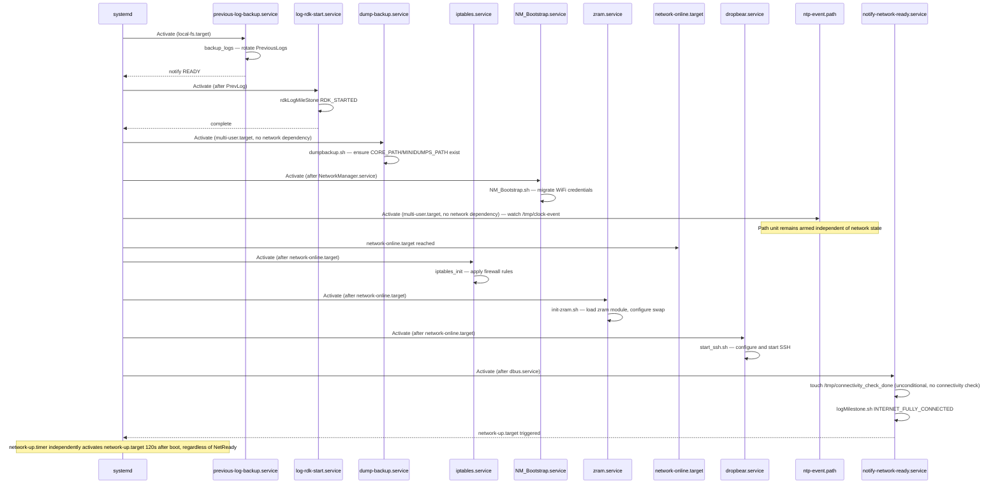

# Sysint — Design & Architecture

[← Sysint](../README.md) · [Configuration](CONFIGURATION.md) · [Component Interactions](INTERACTIONS.md)

## Design Principles

Sysint is designed as a systemd-centric, script-driven integration layer. Rather than a single long-running daemon, it decomposes each functional responsibility into a dedicated, focused systemd unit — a service, timer, or path unit — that activates only when its specific trigger condition is met. This keeps each unit independently auditable, restartable, and orderable against other units without creating a central point of failure. Most behavior is expressed in POSIX shell scripts that are easy to read, patch at the field level, and override by replacing individual files. Performance- or security-sensitive responsibilities — previous-boot log backup, DCM log upload, and reboot management — are implemented as companion C binaries that Sysint's systemd units and shell scripts invoke rather than implement directly.

Scripts load shared property files as needed rather than under one universal contract. Scripts that source `utils.sh` inherit `/etc/common.properties`, `/etc/include.properties`, `/etc/device.properties`, and `/etc/env_setup.sh`, while standalone scripts source only the property files they require — for example `NM_Dispatcher.sh` sources only `/etc/device.properties` and `/etc/common.properties`, and `getPartnerProperty.sh` and `send-time-events.sh` source none of them. This allows paths such as `LOG_PATH`, `UTILITY_PATH`, and `PERSISTENT_PATH`, and interface names such as `ESTB_INTERFACE` and `WIFI_INTERFACE`, to be supplied per platform rather than hardcoded.

Interaction with the northbound RDK middleware (other systemd services, Thunder plugins) is achieved through two mechanisms: filesystem path units that watch for sentinel files written by those services, and system event bus signals dispatched by `IARM_event_sender` for coarser platform-wide event delivery. Interaction with the southbound OS layer uses standard POSIX interfaces — `systemctl`, `iptables`, `modprobe`, `dbus-send`, and procfs/sysfs.

Data created by Sysint that must survive across reboots is written to the persistent storage path (`/opt`). Previous-boot log snapshots are retained in `/opt/logs/PreviousLogs/`. Reboot metadata under `/opt/secure/reboot/` (`reboot.info`, `rebootCounter`) is written and read by the externally supplied `rebootNow` binary, not by Sysint scripts, though Sysint's reset scripts rely on it indirectly by invoking that binary. Transient state (PID lock files, connectivity flags, NTP event markers) is written to `/tmp` and is automatically discarded at each reboot.

RFC-controlled feature toggles are read at script invocation time via the `tr181Set` utility, enabling features such as ZRAM (`Device.DeviceInfo.X_RDKCENTRAL-COM_RFC.Feature.MEMSWAP.Enable`), USB storage auto-mount, OCSP/CRL policy, and SSH whitelist enforcement to be changed remotely without image reflash.

```mermaid
graph TD
    subgraph SysintComp["Sysint"]
        Utils["Utility Library<br/>utils.sh / logfiles.sh"]
        LM["Log Management<br/>backup_logs (C binary) · logrotate"]
        NMod["Network Management<br/>NM_Bootstrap · NM_Dispatcher<br/>networkConnectionRecovery"]
        SEC["Security<br/>iptables_init · start_ssh<br/>ocsp-support"]
        MON["System Monitoring<br/>system_info_collector<br/>cpu-statistics · heap-usage-stats"]
        TS["Time Sync Events<br/>ntp-event · send-time-events<br/>ntp-time-sync-event"]
        CRASH["Crash Management<br/>dumpbackup · coredump-upload<br/>minidump-upload"]
        DISK["Disk Management<br/>disk_threshold_check<br/>diskMon"]
        DID["Device Identity<br/>getDeviceId · getDeviceDetails"]
        SLC["Reset & Recovery<br/>factory-reset · warehouse-reset<br/>stateRedRecovery"]
        MEM["Memory Management<br/>init-zram"]
        MAINT["Maintenance<br/>Start_MaintenanceTasks"]
    end

    subgraph Ext["External Components"]
        NMSvc["NetworkManager"]
        Systemd["systemd"]
        DBus["D-Bus"]
        RFC["RFC / tr181Set"]
        CloudExt["Crash / Log Servers"]
        EvtBus["System Event Bus"]
    end

    Utils --> LM
    Utils --> NMod
    Utils --> SEC
    Utils --> MON
    Utils --> SLC
    NMod --> NMSvc
    TS --> DBus
    TS --> EvtBus
    CRASH --> CloudExt
    SEC --> RFC
    MEM --> RFC
    DID --> Systemd
    LM --> Systemd
    MAINT --> EvtBus
```

## Threading Model

- **Threading Architecture**: All execution is through POSIX shell scripts; each service unit invocation runs as a single-threaded OS process.
- **Main Thread**: Each systemd-activated script runs as a dedicated short-lived process. One-shot services exit after completing their action; timer-triggered services are re-launched by the timer on each interval.
- **Background Execution**: Select scripts fork themselves into the background using the shell `&` operator (`init-zram.sh`, `getDeviceDetails.sh`) so that the parent systemd unit can return without blocking the boot target.
- **Synchronization**: Concurrent-instance protection is implemented with PID lock files (e.g., `/tmp/DiskCheck.pid` in `disk_threshold_check.sh`, `/tmp/SSH.pid` in `start_ssh.sh`). A script checks for an existing PID file and exits if a live instance is already running.
- **Async / Event Dispatch**: Systemd path units (`ntp-event.path`, `network-up.path`, `ntp-time-sync.path`, `restart-parodus.path`) watch filesystem paths and activate the corresponding service asynchronously when the watched file appears or changes, decoupling the writing component from the consuming service.

## Prerequisites and Dependencies

### Platform and Integration Requirements

- **Build Dependencies**: `crashupload` component (Yocto `DEPENDS`); `syslog-ng-config-gen` and `logrotate_config` Yocto class inheritance for log routing and rotation rule generation.
- **Runtime Dependencies**: `bash`, `busybox` (declared as `RDEPENDS`); `logrotate`, `dropbear`, `NetworkManager`, `tr69hostif`, and `parodus` services must be present on the target image. Either `systemd-timesyncd` or `chronyd` must be present as the active time-sync daemon — the two are mutually exclusive and selected at runtime via the `Device.Time.ChronyEnable` RFC parameter.
- **Companion Executables**: Sysint's shell scripts and systemd units no longer implement log backup, log upload, or reboot management directly — they depend on separately built/installed binaries being present on the image: `/usr/bin/backup_logs` (invoked by `previous-log-backup.service`), `/usr/bin/logupload` (the DCM Agent binary invoked by `Start_MaintenanceTasks.sh`), and `/lib/rdk/rebootNow.sh` (an externally supplied reboot-management binary, symlinked at the image root by Sysint's `Makefile`).
- **Systemd Services**: The following services must be present before Sysint services reach full operational state: `nvram.service`, `securemount.service`, `tr69hostif.service`, `NetworkManager.service`, `dbus.service`, `network-online.target`.
- **Configuration Files**: `/etc/device.properties`, `/etc/common.properties`, `/etc/include.properties`, `/etc/env_setup.sh`, `/etc/diskMon.conf`, and `/etc/rfcdefaults/sysint-generic.ini` must be installed at the paths defined in `do_install()`. See [Configuration](CONFIGURATION.md) for the full variable reference.
- **Startup Order**: `previous-log-backup.service` runs before `log-rdk-start.service`; both run before `multi-user.target`. Crash and dump upload services declare `After=network-online.target`.

## Component State Flow

### Initialization to Active State

On each boot, Sysint's units activate according to their individual systemd ordering declarations rather than one guaranteed serial sequence. `previous-log-backup.service` and `log-rdk-start.service` are ordered `Before=multi-user.target` and anchored to `local-fs.target`, so they run once the local filesystem and NVRAM are available. A functional group of units reaches `multi-user.target` with no network dependency — `dump-backup.service`, `oops-dump.service` (both anchored to `local-fs.target`), and `NM_Bootstrap.service` (ordered `After=NetworkManager.service`) — so none of these are guaranteed to run before or after network bring-up. `iptables.service` and `zram.service` are separately declared `After=network-online.target`, as are `dropbear.service` and `update-device-details.service`. `ntp-event.path`, by contrast, declares no ordering dependency on `network-online.target`: it is armed as soon as `multi-user.target` is reached and fires whenever the time-sync daemon writes its sentinel file, independent of network state. `network-up.target` is activated through two independent, unconditional paths that do **not** verify internet connectivity: `notify-network-ready.service` touches `/tmp/connectivity_check_done` as soon as `dbus.service` is active (no connectivity check is performed), which `network-up.path` detects; and `network-up.timer` activates `network-up.target` directly 120 seconds after boot regardless of whether `notify-network-ready.service` has run. Either path unblocks services ordered after `network-up.target`, so that target should be read as "network bring-up assumed complete," not as confirmed internet connectivity.

The following functional groups describe what each unit does, not a guaranteed serial pipeline: **LogRecovery** (backup previous logs, mark RDK_STARTED), **SecuritySetup** (iptables rules and ZRAM, both ordered after `network-online.target`; OCSP flags), **NetworkBringup** (NM bootstrap ordered after `NetworkManager.service`; dispatcher registration), and **TimeSyncMonitoring** (NTP path armed at `multi-user.target`, independent of network state). Once these groups have run, Sysint reaches **Active** state (all timers running, crash upload paths watching, connection stats running) until **Shutdown** (individual services stopped via `systemctl stop`).

The sequence diagram below covers the boot flow end-to-end, from log recovery through network-up target activation:

### Runtime State Changes

Once all boot-time services have completed, Sysint operates through timer-driven and path-driven activations, re-entering active execution each time a timer fires or a watched filesystem path changes.

**State Change Triggers:**

- `vitalprocess-info.timer` fires 150 seconds after boot and every 600 seconds thereafter, invoking `system_info_collector.sh` to collect CPU, memory, disk, and process metrics and emit Telemetry 2.0 markers.
- `logrotate.timer` runs on its configured schedule, invoking `logrotate` against `/etc/logrotatedata.conf` to cap log file sizes.
- `disk-threshold-check.timer` periodically invokes `disk_threshold_check.sh` to detect and remediate persistent storage exceeding configured thresholds.
- `network-connection-stats.timer` periodically invokes `networkConnectionRecovery.sh` to check gateway reachability, packet loss, and WiFi driver health; it triggers reassociation or a driver reset when configurable thresholds are exceeded.
- `ntp-event.path` watches `/tmp/clock-event` (or `/run/systemd/timesync/synchronized` on Dunfell builds). When the time-sync daemon writes this file, `ntp-event.service` fires, dispatching a system event bus signal `NTPReceivedEvent` and logging the `CONNECT_TO_NTP_SERVER` milestone.
- `restart-parodus.path` watches `/tmp/authservice_parodus_restart`. When this file appears, `restart-parodus.service` (ordered `After=wpeframework.service`) invokes `systemctl restart parodus.service`. This is an ordering constraint only — it does not start Thunder or verify that `wpeframework.service` is currently active; the restart proceeds once that ordering point is reached even if Thunder is inactive or failed.
- `stateRedRecovery.path` watches a sentinel file; when triggered, `stateRedRecovery.sh` initiates a recovery firmware download via `rdkvfwupgrader`.

**Context Switching Scenarios:**

- **Factory Reset**: `factory-reset.sh` stops dependent services (sysmgr, storagemgr, socprovisioning, lighttpd, dnsmasq, Dobby, WiFi), clears controller-pairing data and persistent state, and requests a reboot by invoking the external `rebootNow` binary.
- **Warehouse Reset**: `warehouse-reset.sh` follows a similar service teardown sequence with warehouse-specific data erasure.
- **State Red**: `stateRedRecovery.sh` calls `rdkvfwupgrader` with recovery parameters to initiate an emergency firmware download without requiring a full UI-driven update.
- **Cyclic Reboot Detection**: This guard is implemented in the externally supplied `rebootNow` binary, not in Sysint. Sysint's reset scripts simply call that binary; the counter at `/opt/secure/reboot/rebootCounter` and the pause-window logic (`REBOOT_CYCLE_THRESHOLD=5` within `REBOOT_WINDOW=10` minutes) are owned and maintained by the separate reboot-management component.

> **Note:** Reboot management is implemented by an externally supplied `rebootNow` binary (`/lib/rdk/rebootNow.sh`, symlinked at the image root by Sysint's `Makefile`), not by Sysint itself. Sysint's reset and recovery scripts (`factory-reset.sh`, `warehouse-reset.sh`, `stateRedRecovery.sh`, `utils.sh:rebootFunc()`) only invoke that binary; its caller classification, cyclic-reboot guard, and reboot-metadata persistence are owned by that separate component.

## Implementation Details

### Hardware Interface Usage

Sysint interacts with hardware through standard Linux kernel interfaces. CPU and memory metrics are read from procfs paths including `/proc/cpuinfo` and `/proc/uptime`. Thermal readings and ION heap information are retrieved from sysfs at `/sys/class/thermal/thermal_zone0/temp` and `/sys/kernel/debug/ion/heaps/`. Storage utilization is measured using `df` and filesystem utilities. Kernel modules including `zram` are managed via `modprobe`. Network packet filtering rules are applied through `iptables` and `ip6tables` calls within `iptables_init`.

### Key Implementation Logic

- **State / Lifecycle Management**: Factory and warehouse reset states are signaled to dependent services by stopping them via `systemctl stop` before clearing data; the final reboot request is delegated to the externally supplied `rebootNow` binary, which owns the reboot counter and metadata files under `/opt/secure/reboot/` (`reboot.info`, `rebootCounter`) — this state is not tracked by Sysint itself.
  - Reset orchestration: `lib/rdk/factory-reset.sh`, `lib/rdk/warehouse-reset.sh`, `lib/rdk/stateRedRecovery.sh`

- **Event Processing**: All event dispatch in Sysint is one-shot and synchronous within the activating script. Systemd path units provide the asynchronous edge-trigger mechanism: the component that writes the sentinel file is decoupled from the consuming service — each side operates independently. System event bus notifications are dispatched as fire-and-forget calls via the `IARM_event_sender` utility.

- **Error Handling Strategy**: Scripts use early-exit patterns when mandatory arguments or files are missing (e.g., `getPartnerProperty.sh` exits with a usage message if its single required argument is missing). Disk threshold checks write a PID lock file and exit immediately if a concurrent instance is detected. The network recovery script tracks consecutive failure counts per condition type before taking corrective action, avoiding false-positive resets.

- **Logging & Diagnostics**: All scripts use a consistent log pattern: ``echo "`/bin/timestamp`: $0: $*" >> $LOG_FILE``. `Start_MaintenanceTasks.sh` maintains dedicated per-task logs (`rfcscript.log`, `swupdate.log`, `dcmscript.log`) under `$LOG_PATH`. The network recovery script writes to `/opt/logs/ConnectionStats.txt`. Systemd unit logs are captured by syslog-ng into service-specific destinations configured at build time via the `SYSLOG-NG_*` variables in the Yocto recipe.

## Internal Modules — Full Functionality Mapping

The [README](../README.md#key-responsibilities--modules) summarizes the primary modules; the remaining scripts and systemd units in `lib/rdk/` and `systemd_units/` are mapped below by functionality.

**Crash & Diagnostics Logging**

| File                                        | Type          | Functionality                                                                                          |
| ------------------------------------------- | ------------- | ------------------------------------------------------------------------------------------------------ |
| `core_shell.sh`                             | script        | Handles core dump uploads to the crash portal and manages dump directory cleanup.                      |
| `diskCleanup.sh`                            | script        | Removes old coredump/cache files once `/opt/corefiles*` exceed the configured size threshold.          |
| `reportFailuresToSplunk.sh`                 | script        | Sends failure telemetry events to the Splunk endpoint resolved from RFC/DCM settings.                  |
| `vm_cpu_temp-check.sh`                      | script        | Collects VM/CPU temperature stats during light sleep (`temperature-telemetry.sh`, `vm-statistics.sh`). |
| `ubifs-node-setup`                          | script        | Sets up the kernel OOPS (panic) dump module on NAND or eMMC storage.                                   |
| `systemd_units/oops-dump.service`           | service       | Initializes kernel panic (OOPS) dump capture by running `ubifs-node-setup` after `local-fs.target`.    |
| `systemd_units/dumpdata.service` / `.timer` | service/timer | Runs `emmc_debug_launcher.sh` 900s after boot to configure a recurring `dumpDummyData.sh` cron job when the helper is installed and `/opt/.disable_data_dump` is absent. |

**Firmware / Image Management**

| File                     | Type   | Functionality                                                                                                                        |
| ------------------------ | ------ | ------------------------------------------------------------------------------------------------------------------------------------ |
| `imageFlasher.sh`        | script | Flashes firmware images to device storage (uses `/usr/bin/FlashApp` on media clients).                                               |
| `eMMC_Upgrade.sh`        | script | Manages eMMC firmware upgrade with RFC version checks and retry tracking.                                                            |
| `emmc_format.sh`         | script | Unmounts filesystems and reformats the MMC devices/partitions found in the mount table using `mkfs`, destroying their existing data. |
| `emmc_debug_launcher.sh` | script | Configures a `dumpDummyData.sh` cron job using interval/size settings from `/opt/emmc_debug_config`, with defaults when absent; exits if `/opt/.disable_data_dump` exists.            |
| `swupdate_utility.sh`    | script | Device-initiated firmware download handler integrated with DCM settings.                                                             |
| `userInitiatedFWDnld.sh` | script | User-initiated firmware download with device state tracking.                                                                         |
| `xconfImageCheck.sh`     | script | Checks firmware update status against the XConf configuration server.                                                                |
| `restore`                | script | Reverts to the previous firmware version from a `.prev.tgz` backup and reboots.                                                      |
| `rfcOverrides.sh`        | script | Enables the SD-card scratchpad for firmware downloads when the RFC flag is set.                                                      |

**Device Identity & Provisioning**

| File                       | Type   | Functionality                                                                           |
| -------------------------- | ------ | --------------------------------------------------------------------------------------- |
| `getPartnerId.sh`          | script | Retrieves partner ID / device ID from provisioned sources, WHOAMI RFC, or auth service. |
| `getAccountId.sh`          | script | Validates and retrieves the account ID from a `tr181` parameter.                        |
| `serialNumber.sh`          | script | Retrieves the device serial number from `tr181` or the kernel command line.             |
| `insertPartnerId.sh`       | script | Generates a UUID and sets up device/partner IDs for the auth service.                   |
| `isDeviceProvisioned`      | script | Returns success if device/partner ID provisioning files exist.                          |
| `getNonRootUserStatus.sh`  | script | Checks the non-root-user RFC flag and creates `/tmp/.EnableNonRootUser`.                |
| `readBTAddress-generic.sh` | script | Reads the device Bluetooth MAC address from hardware.                                   |

**Reset & Cleanup**

| File                      | Type   | Functionality                                                                           |
| ------------------------- | ------ | --------------------------------------------------------------------------------------- |
| `deviceReset.sh`          | script | Dispatches reset requests to the factory/warehouse/personality/user-reset handlers.     |
| `personality-reset.sh`    | script | Performs a personality reset by delegating to `factory-reset.sh`.                       |
| `userfactory-reset.sh`    | script | User-triggered factory reset; clears TTS language data then calls `warehouse-reset.sh`. |
| `restrictedModeUmount.sh` | script | Unmounts restricted-mode bind-mount filesystems under `/opt/restricted`.                |
| `restoreRootEnv.sh`       | script | Restores root ownership of system directories after restricted mode.                    |

**Disk & Storage Management**

| File                                                             | Type    | Functionality                                                               |
| ---------------------------------------------------------------- | ------- | --------------------------------------------------------------------------- |
| `disk_init`                                                      | script  | Initializes SD-card partitions with the expected TSB/APP layout.            |
| `disk_checkV2`                                                   | script  | Checks and repairs SD-card filesystems and mount/read-write status. `start`/`restart` reformat the target partition; repair paths also reformat on `e2fsck` exit codes 4 or 8, destroying existing data. |
| `systemd_units/disk-check.service` / `disk-check-sdcard.service` | service | Run disk initialization/health checks after local filesystem mounts.        |
| `updateMountFailureCount.sh`                                     | script  | Aggregates mount-failure counters from `/tmp` into persistent storage.      |
| `systemd_units/mount-failure-count.service`                      | service | Runs `updateMountFailureCount.sh` on boot, after `nvram.service`.           |

**Network & Connectivity Extras**

| File                                                     | Type         | Functionality                                                                                 |
| -------------------------------------------------------- | ------------ | --------------------------------------------------------------------------------------------- |
| `ipv6addressChange.sh`                                   | script       | Logs IPv6 global-address acquisition and refreshes firewall rules.                            |
| `startLinkLocal.sh`                                      | script       | Starts `avahi-autoipd` for IPv4 link-local addressing on configured interfaces.               |
| `startTunnel.sh` / `startStunnel.sh`                     | script       | Manage SSH/stunnel reverse-tunnel lifecycle, including certificate handling.                  |
| `systemd_units/dnsmerge@.service` / `dnsmerge-upnp.path` | service/path | Merge DNS configuration fragments into `resolv.conf` when `/tmp/resolv.dnsmasq.upnp` changes. |
| `systemd_units/dropbear.service`                         | service      | Starts the Dropbear SSH daemon after network and `tr69hostif` are ready.                      |
| `systemd_units/NetworkManager.path`                      | path         | Triggers `NetworkManager` activation when `/tmp/bootType` appears.                            |
| `systemd_units/estb-interface-presetup.service`          | service      | Configures the default eSTB IP address and routes before `multi-user.target`.                 |

**USB & Input Device Control**

| File                                                                   | Type           | Functionality                                                     |
| ---------------------------------------------------------------------- | -------------- | ----------------------------------------------------------------- |
| `disableUSBEthernet.sh`                                                | script         | Validates USB Ethernet devices against a vendor/model allow-list. |
| `usbmodule-whitelist.sh` / `systemd_units/usbmodule-whitelist.service` | script/service | Always loads `usbhid`; loads `usb-storage` only when the `USB_AutoMount.Enable` RFC is true.           |
| `systemd_units/usb-input@.service`                                     | service        | Disables unauthorized USB input devices (templated per device).   |

**Power & Thermal Management**

| File                                        | Type    | Functionality                                                                     |
| ------------------------------------------- | ------- | --------------------------------------------------------------------------------- |
| `togglePower`                               | script  | Queries and toggles the device power state via `QueryPowerState`/`SetPowerState`. |
| `temperature-telemetry.sh`                  | script  | Collects board temperature from sysfs and reports it via `t2ValNotify`.           |
| `systemd_units/power-state-monitor.service` | service | Runs the `pwr-state-monitor` daemon to track power-state transitions.             |

**Time Synchronization Extras**

| File                                             | Type        | Functionality                                                                    |
| ------------------------------------------------ | ----------- | -------------------------------------------------------------------------------- |
| `timesyncd-conf-update.sh`                       | script      | Updates `systemd-timesyncd` NTP configuration from partner properties/bootstrap. |
| `systemd_units/system-time-event.service`        | service     | Runs `send-time-events.sh systimeset` after `dbus.service`.                      |
| `systemd_units/system-time-set.path` / `.target` | path/target | Watches `/tmp/systimeset` and activates `system-time-set.target`.                |

**Status Loggers & Telemetry**

| File                                                                                                                      | Type          | Functionality                                                                 |
| ------------------------------------------------------------------------------------------------------------------------- | ------------- | ----------------------------------------------------------------------------- |
| `vm-statistics.sh`                                                                                                        | script        | Collects virtual-memory statistics (`vmstat`) for Telemetry 2.0.              |
| `systemd_units/av-status-logger.service`                                                                                  | service       | Logs audio/video decoder status.                                              |
| `systemd_units/proc-status-logger.service` / `.timer`                                                                     | service/timer | Periodically logs SOC processor status.                                       |
| `systemd_units/rf-status-logger.service`                                                                                  | service       | Collects RF (radio) statistics after `network-online.target`.                 |
| `systemd_units/eth-connection-stats.timer`, `network-statistics.timer`, `hddstatuslogger.timer`, `mocastatuslogger.timer` | timer         | Periodic Ethernet, upstream network, disk-health, and MoCA status collection. |
| `systemd_units/vitalprocess-info.service`                                                                                 | service       | Runs `system_info_collector.sh`, triggered by `vitalprocess-info.timer`.      |

**Security & Certificates**

| File                                 | Type    | Functionality                                                               |
| ------------------------------------ | ------- | --------------------------------------------------------------------------- |
| `copyPRCerts.sh`                     | script  | Copies PlayReady DRM certificates into `/opt/drm/`.                         |
| `cleanAdobe.sh`                      | script  | Cleans Adobe DRM and Netflix secure data on STB version change.             |
| `systemd_units/ocsp-support.service` | service | Runs `ocsp-support.sh` after `securemount.service` to apply OCSP RFC flags. |

**Content & Application Management**

| File                                      | Type   | Functionality                                                                    |
| ----------------------------------------- | ------ | -------------------------------------------------------------------------------- |
| `bundleUtils.sh` / `cdlSupport.sh`        | script | Parse and manage software bundle / content-delivery-layer metadata.              |
| `netflixPreStart.sh`                      | script | Pre-startup setup for the Netflix application (UID/GID, DRM ownership).          |
| `systemd_units/netflix-download-lxc.path` | path   | Watches `/tmp/.netflix-download-lxc` and triggers the Netflix container service. |

**Cron, Scheduling & Misc Utilities**

| File                                                                | Type    | Functionality                                                                           |
| ------------------------------------------------------------------- | ------- | --------------------------------------------------------------------------------------- |
| `cronjobs_update.sh` / `add_cron_jobs.sh`                           | script  | Add, update, and verify crontab entries for periodic monitoring scripts.                |
| `init-functions`                                                    | script  | Shared shell initialization/formatting helpers (sourced by init-style scripts).         |
| `module-starter`                                                    | script  | Generic module-startup wrapper that redirects output to a log pipe.                     |
| `alertSystem.sh`                                                    | script  | Dispatches alert messages to backend endpoints via `exec_curl_mtls.sh`.                 |
| `fkps.sh`                                                           | script  | Resolves Kaleidescape Provisioning Server URLs from RFC or config.                      |
| `getTimeZone.sh`                                                    | script  | Resolves device timezone from provisioning files or properties.                         |
| `timestamp`                                                         | script  | Prints an ISO-format timestamp used in every script's log line.                         |
| `systemd_units/htmldiag-pre.service`                                | service | Pre-setup for the HTML diagnostics interface after `network-online.target`.             |
| `systemd_units/update-device-details.service` / `.conf`             | service | Runs `getDeviceDetails.sh` after network is online to refresh the device-details cache. |
| `systemd_units/systemd-tmpfiles-setup.conf`, `after_syslog-ng.conf` | conf    | Unit-ordering constraints (`/var/lib` mount, `syslog-ng.service` ordering).             |
