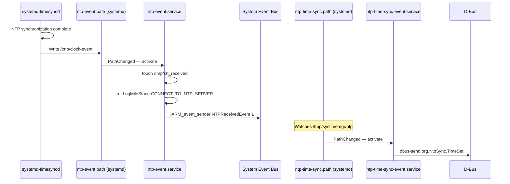
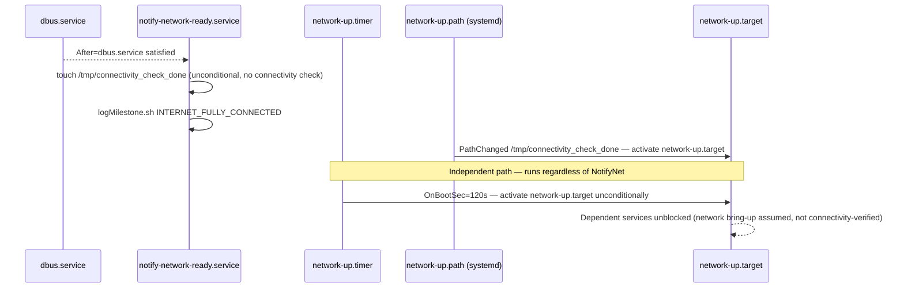

# Sysint — Component Interactions

[← Sysint](../README.md) · [Design & Architecture](DESIGN.md) · [Configuration](CONFIGURATION.md)

## Interaction Matrix

| Target Component / Layer           | Interaction Purpose                                                                                                                                                                                                                                   | Key APIs / Topics                                                                                                    |
| ---------------------------------- | ----------------------------------------------------------------------------------------------------------------------------------------------------------------------------------------------------------------------------------------------------- | -------------------------------------------------------------------------------------------------------------------- |
| **OS Services**                    |                                                                                                                                                                                                                                                       |                                                                                                                      |
| `NetworkManager`                   | Receives IP add/del events and pre-down notifications via dispatcher scripts registered in `/etc/NetworkManager/dispatcher.d/`                                                                                                                        | `NM_Dispatcher.sh`, `NM_preDown.sh`                                                                                  |
| `systemd-timesyncd` / `chronyd`    | Path unit watches the time-sync sentinel file to trigger NTP event dispatch; the active daemon (one or the other, never both) is selected via the `ChronyEnable` RFC flag, and `getPartnerProperty.sh` supplies its NTP server and polling parameters | `ntp-event.path` watches `/tmp/clock-event` (or `/run/systemd/timesync/synchronized`); `Device.Time.ChronyEnable`    |
| `parodus.service`                  | Restarts parodus after WPEFramework signals readiness, triggered by the `authservice_parodus_restart` sentinel                                                                                                                                        | `restart-parodus.path`, `systemctl restart parodus.service`                                                          |
| `logrotate`                        | Periodic log file rotation using Sysint-installed configuration                                                                                                                                                                                       | `logrotate.service` invokes `/usr/sbin/logrotate -s ... /etc/logrotatedata.conf`                                     |
| `dnsmasq` / Dobby container bridge | Supplies DNS resolution on the `dobby0` container interface used by Dobby-hosted applications                                                                                                                                                         | `etc/dnsmasq-dobby.conf` (`interface=dobby0`)                                                                        |
| **RDK Middleware Components**      |                                                                                                                                                                                                                                                       |                                                                                                                      |
| `WPEFramework` (Thunder)           | Stopped/restarted as part of factory reset, warehouse reset, and the parodus-restart flow; `restart-parodus.service` waits for `wpeframework.service` to be active before restarting parodus                                                          | `systemctl stop/restart wpeframework.service` in `factory-reset.sh`, `warehouse-reset.sh`, `restart-parodus.service` |
| Dobby container runtime            | Stopped during factory/warehouse reset teardown; provided DNS resolution via `dnsmasq-dobby.conf`                                                                                                                                                     | `systemctl stop Dobby` in `factory-reset.sh`/`warehouse-reset.sh`                                                    |
| DCM Agent (`/usr/bin/logupload`)   | Performs the actual log-upload transfer; Sysint only triggers it and supplies `dcm.properties`/`DCMSettings.conf` context                                                                                                                             | `LOG_UPLOAD_BIN_PATH=/usr/bin/logupload` in `Start_MaintenanceTasks.sh`                                              |
| Reboot-management binary           | External component that owns reboot classification, cyclic-reboot guarding, and reboot metadata; invoked (never implemented) by Sysint's reset scripts                                                                                                | `/rebootNow.sh` invoked from `factory-reset.sh`, `warehouse-reset.sh`, `utils.sh:rebootFunc()`                       |
| `rdkvfwupgrader`                   | Performs firmware download/flash on behalf of maintenance tasks and state-red recovery                                                                                                                                                                | `SWUPDATE_BIN=$COMMON_BIN_LOCATION/rdkvfwupgrader` in `Start_MaintenanceTasks.sh`; `stateRedRecovery.sh`             |
| `syslog-ng`                        | Routes per-service journal output into dedicated log files under `/opt/logs/` using build-time generated filter/destination rules                                                                                                                     | `SYSLOG-NG_*` Yocto recipe variables; `systemd_units/after_syslog-ng.conf`                                           |
| **System Event Bus**               |                                                                                                                                                                                                                                                       |                                                                                                                      |
| Event bus signal sender            | Dispatches `NTPReceivedEvent` to the platform-wide event bus on NTP synchronization                                                                                                                                                                   | `IARM_event_sender NTPReceivedEvent 1` in `ntp-event.service`                                                        |
| Event bus signal sender            | Dispatches maintenance progress and completion events during RFC, firmware update, and log upload sequences                                                                                                                                           | `IARM_event_sender` calls in `Start_MaintenanceTasks.sh`                                                             |
| **D-Bus**                          |                                                                                                                                                                                                                                                       |                                                                                                                      |
| `org.Systime`                      | Broadcasts `TimeSet` signal when system time is set to last-known-good or build time                                                                                                                                                                  | `dbus-send --system … org.Systime.TimeSet`                                                                           |
| `org.NtpSync`                      | Broadcasts `TimeSet` signal on NTP sync completion or 180-second expiry                                                                                                                                                                               | `dbus-send --system … org.NtpSync.TimeSet`                                                                           |
| **RFC / Configuration Store**      |                                                                                                                                                                                                                                                       |                                                                                                                      |
| `tr181Set` / `tr181` utility       | Reads RFC-controlled feature flags at script invocation time                                                                                                                                                                                          | `Device.DeviceInfo.X_RDKCENTRAL-COM_RFC.Feature.*` parameters                                                        |
| **Cloud Services**                 |                                                                                                                                                                                                                                                       |                                                                                                                      |
| Crash upload server                | Transfers core dumps and mini-dumps via the `uploadDumps.sh` helper after network is available                                                                                                                                                        | `coredump-upload.service`, `minidump-upload.service`                                                                 |
| DCM / log upload server            | Receives uploaded logs from the `/usr/bin/logupload` DCM Agent binary                                                                                                                                                                                 | `etc/dcm.properties` (`DCM_LOG_SERVER`, `DCM_LOG_SERVER_URL`, `DCM_SCP_SERVER`)                                      |
| XConf / firmware update server     | Supplies firmware update availability and download location, consumed by `xconfImageCheck.sh` and `rdkvfwupgrader`                                                                                                                                    | `swupdate_utility.sh`, `xconfImageCheck.sh`                                                                          |
| **Telemetry 2.0**                  |                                                                                                                                                                                                                                                       |                                                                                                                      |
| `t2Shared_api.sh`                  | Emits telemetry markers for CPU, memory, and network statistics                                                                                                                                                                                       | `t2ValNotify "cpuinfo_split"`, `t2ValNotify "FREE_MEM_split"`, `t2ValNotify "ConnectionStats"`                       |

## Events Published

| Event Name                 | Topic / Signal    | Trigger Condition                                                                                                                                                                                                                                                                      | Subscriber Components                                    |
| -------------------------- | ----------------- | -------------------------------------------------------------------------------------------------------------------------------------------------------------------------------------------------------------------------------------------------------------------------------------- | -------------------------------------------------------- |
| `NTPReceivedEvent`         | System event bus  | Time-sync daemon writes `/tmp/clock-event` (path unit fires)                                                                                                                                                                                                                           | Time-dependent middleware services                       |
| `org.Systime.TimeSet`      | D-Bus system bus  | `system-time-set.target` activated                                                                                                                                                                                                                                                     | Services listening on D-Bus for system time availability |
| `org.NtpSync.TimeSet`      | D-Bus system bus  | `ntp-time-sync.target` activated                                                                                                                                                                                                                                                       | Services listening on D-Bus for NTP synchronization      |
| `INTERNET_FULLY_CONNECTED` | RDK log milestone | `notify-network-ready.service` touches the sentinel unconditionally once `dbus.service` is active, or `network-up.timer` fires 120s after boot — neither path verifies actual internet connectivity, so this milestone name is aspirational rather than a confirmed-connectivity check | Log analysis, boot milestone tracking                    |
| `RDK_STARTED`              | RDK log milestone | `log-rdk-start.service` runs before `multi-user.target`                                                                                                                                                                                                                                | Boot milestone tracking                                  |
| Maintenance status events  | System event bus  | Each phase of RFC fetch, firmware update, and log upload                                                                                                                                                                                                                               | Maintenance Manager plugin                               |

## IPC Flow Patterns

**NTP Event Notification Flow:**

The NTP event chain is driven entirely by filesystem path monitoring. No polling occurs: systemd watches the sentinel file, and the event dispatch service activates only when the condition is met.

**Network-Up Target Activation Flow:**

`network-up.target` marks that network bring-up is assumed complete; it is not a verified-connectivity signal. `NM_Dispatcher.sh` only refreshes the local IP/gateway cache on interface events and has no relationship to `notify-network-ready.service` or `network-up.timer` — the two activation paths below are independent of it and of each other.

